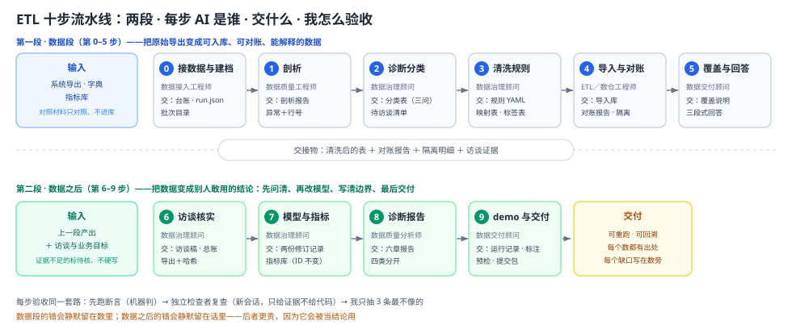

# ETL 通用工作手册（0–9 步）

> **版本 v1.6** ｜ 2026-11-13
> 变更：v1.0 首版（0–9 步 ＋ 11 条指令 ＋ 4 件通用工具）；v1.1 拆出知识库 `02`、补通用件三/四；v1.2 定制手册要求新增「怎么验收」「产物与回溯」两块，并强制带版本号；v1.3 通用件二由"验收三件套"改为"验收四件套"，新增第 ④ 件「查回溯件」；v1.4 补"每交一步必须停"前置纪律、四行汇报里并入回溯件；v1.5 附录一新增「中途变了怎么办」；**v1.6 第 3 步验收新增「字段验」：行数对只说明没丢记录，不说明没丢值——按列位置比非空率，整列丢值即 FAIL（`check.py` 已带这条断言）。**
> 每次改本手册都要加版本号：改口径／实值 ＋0.1，改结构 ＋1.0。

> 全流程一张图（十步两段）见下面的「总览」。

## 先读这里：这份手册怎么用

> 来源：一个连锁零售会员经营项目的完整实施（六场角色访谈、38 项指标、两条 demo 全流程走完后的复盘）。「实战校准」标记的部分来自实战，与方法论本身分开；示例数据均为合成数据。**这份手册是给"前端出身、不熟 ETL、靠 AI 干数据整理"的自己用的**——拿到一份客户数据，从剖析走到回答，每一步知道吩咐 AI 做什么、自己盯什么、什么时候问业务方、怎么验收 AI 的活。
>
> 我的角色定位（V04 p7–p8）：**我是需求方和验收方，AI 是执行方**。我负责确认输入、定规则、验收结果；AI 负责写代码、跑统计、出报告。判断分工是否划算的标准只有一条：**验收成本是否明显低于我自己从头做**——如果 AI 的产出我审不出来对错，那就不叫验收，叫点头。
>
> 来源：本人多个数据工程项目的实战与复盘。标注"前端类比"的条目是同行补充的迁移理解，**不属于方法论本体**。

手册有**两种用法，取决于你现在处在哪种局面**：

**用法一：手头有一批数据要做（本会话直接开工）**

1. 先看同目录 **`ETL-进度台账.md`** 确认当前在第几步（新项目就照台账末尾的空白模板起步），再按它的"下一步发什么"列取编号（如 C3-A），跳到那一步的 A 段整段复制；
2. 做到哪一步，就回到那一步的 **A 段**——整段复制发给 AI（背景、任务、交证据句都已内联），后面接上它的 **A2 技术卡**，指令开头的身份换成那一步的（数据接入→数据质量→数据治理→数据工程→ETL／数仓→数据交付；第 7 步是数据治理，第 8 步是数据质量／交付，第 9 步是数据交付）；
3. 收活验收，固定三招：**看灯表只扫 FAIL**（AI 自己跑 `check.py` 贴回来）→ **开新会话用那一步 D 段的检查者话术复查** → **自己抽 3 条最不像的**；
4. 卡在"要存什么、怎么回溯"看附录一；想让 AI 产出更可靠看附录二（六道闸）。

**用法二：换了客户、来了新数据（让它产一份定制版操作单）**

一句话：**通用手册不动；每换一个客户，产一份"只写差异、带进度台账"的定制版。**

1. （推荐）新会话先让它学：把 **`02-知识库-K1-K11.md` 整份**发给 AI，用它开头那条 📤 学习指令开场，学完让它**复述要点**——不复述你不知道它读没读进去；
2. **填好四格背景**（客户与目标／数据清单／已发现问题／已问过谁），把 **`03-生成定制手册话术.md`** 里第二节那段 📤 话术整段发过去，并把本手册路径给它；
3. 它交一份 `<项目名>-ETL工作手册.md`：**只写实值与坑、方法论一律用编号引用（C3-A 这种）、必带十行进度台账**；
4. 用那份文件第三节的**四招验收**（搜尖括号／数结构／抽一步读／搜"应该"）；**超 600 行就打回**——说明它在抄书；
5. 之后每天只看定制版的**台账"下一步"列**干活，收工改三格（状态／产出物／判据）。进度怎么盯，见该文件第六节。

> **别搞混两者分工**：通用手册＝怎么做（方法论、指令全文、验收话术）；定制版＝这一单做什么（实值、本单的坑、进度）。**定制版绝不复制通用版正文**——这是它能保持短的唯一原因。

**标注约定**（读正文前记住）：代码块前有 **📤** 的＝整段复制发给 AI（"另开新会话"的要换会话再贴）；**✍️** 的＝我自己先写好再给 AI；没标的＝给我看的说明，不用发。

**结构导览**：**三秒定位**（台账＋指令编号 C0-A～C9-D＋导航话术）→ 总览（流水线两段十步＋四问框架）→ 通用件一～四（交证据句、验收四件套、契约先读、引用编号，每节标了**必读／备查**）→ **第 0–5 步：数据段**（接数据→剖析→诊断分类→清洗规则→导入对账→覆盖与回答）→ **第 6–9 步：数据之后**（访谈核实→模型与指标库修订→诊断报告→demo 与交付）→ 附录一（保存与回溯）→ 附录二（六道闸＋⑦⑧两道补充闸）→ 附录三（知识库，已独立为 `02-知识库-K1-K11.md`）→ checklist 两张。每步都是同一套：发什么指令 → 贴哪张技术卡 → 我盯什么 → 问业务方什么 → 怎么验收。**不必从头读，用编号或台账定位。**

---

## 三秒定位：我现在该发哪条指令

> **这一节专治"用到一半，忘了自己走到哪、下一步该复制哪段"**。三步解决，不用通读手册。

### 第一步：看进度台账，不看脑子

台账文件：**`ETL-进度台账.md`**（与本手册同目录）。每步一行，状态只有四种：

| 状态 | 含义 |
| --- | --- |
| ⬜ 未开始 | 还没动 |
| 🟡 进行中 | 指令已发，活没交完（或断言没过） |
| ✅ 完成 | **产出物真实存在**、该步 D 段断言过了、**该步的回溯件已生成**（三样齐才算） |
| ⛔ 阻塞 | 缺输入／缺人答／等材料，括号里写缺什么 |

台账每行末列就是"下一步发什么"，照着编号取。

### 第二步：按编号取指令（C＝Chapter，步号＋用途）

手册里每条可复制的东西都有编号，共三类：

| 编号形式 | 是什么 | 例 |
| --- | --- | --- |
| **C<步号>-A** | 发给 AI 的**主指令**（整段复制） | C3-A＝第 3 步清洗规则 |
| **C<步号>-A2** | **技术卡**，紧跟在主指令后面贴 | C3-A2 |
| **C<步号>-D** | **检查者话术**，另开新会话用 | C3-D |

第 0 步有两条指令：**C0-A 写台账**、**C0-B 建批次目录＋run.json**，另加 C0-T（技术标准）／C0-D（验收）。**每个编号都印在对应段落标题下面那一行**，搜编号就能跳到位置。

### 第三步：不想翻手册，就粘这句"导航话术"

在任意会话里（含新开的会话）粘这一段，AI 会自己读台账、告诉你下一步、并把指令原文贴出来：

> 📤 **整段复制发给 AI**：
```
先读 <你的工程目录>/04-进度台账模板.md 和同目录的 01-通用手册.md，
这一轮不要改任何文件、不要开始干活。只回答四件事：
1. 我现在在第几步，状态是什么（照台账说，不要替我判断"应该已经做完了"）；
2. 下一步该发哪条指令，编号是什么，在手册哪一步；
3. 把那一条指令的原文**完整贴出来**（一字不改、不补充、不合并技术卡）；
4. 发完之后，我要看到什么才算这一步做完（引用该步 D 段的断言）。
若台账状态是 ⛔，先告诉我缺什么、该找谁，不要往下推进。
```

### 附：AI 每次交活必须回答这四行

这也是判断"AI 执行到什么程度"的唯一标准——**没有这四行，就当我没收到汇报**：

```
当前：第 3 步 · 🟡 进行中
做完：规则 YAML 已写，9 条规则，位 artifacts/b01-20261113/cleaning/cleaning_rules.yaml；回溯件：rules_version=rules-v1（已升版）、改前 .bak 在位
断言：6 条过 5 条，未过＝"每条规则都有样例回放"，缺 2 条规则的回放样例
下一步：补齐回放样例后再发 C3-D；需要你拍板：标签缺失的四种写法是否都拦（我建议都拦）
```

四行分别对应：**我在哪／做了什么＋回溯留了什么／凭什么说做完了／接下来谁动**。验收时看两处——**第二行后半有没有回溯件**（批次目录、版本号、原文），**第三行断言过没过**；两处缺一处都不算完成，不管它说得多完整。

---

## 总览：一条流水线，两段十步



**看图三个要点**（其余细节图里都有，不用记）：

1. **上排是数据段（0–5）**，蓝色：把原始导出变成能入库、能对账、能解释的数据；
2. **下排是数据之后（6–9）**，绿色：把数据变成别人敢用的结论——先问清、再改模型、写清边界、最后交付；
3. **中间那条虚线是交接**：左边交给右边的是「清洗后的表 ＋ 对账报告 ＋ 隔离明细 ＋ 访谈证据」。右边少了这几样就走不动。

**为什么要边做边存**：ETL 三目标（V04 p4）——格式统一、不丢不重、**能追溯能重跑**；落在操作上就是四样分开存（原始/剖析/规则/清洗后），任何一步不覆盖前一步。所以每条指令末行都有一条"落盘"——产物是随做随落的副产品，公共规则见附录一。

**两段差在哪**（三行说清，这也是判断"我现在该用哪种验收方式"的依据）：

| | 数据段（0–5） | 数据之后（6–9） |
| --- | --- | --- |
| 干什么 | 原始导出 → 可入库、可对账、能解释的数据 | 数据 → 别人敢拿去作决定的结论 |
| 每步交什么 | 台账／剖析报告／分类表／规则 YAML／对账报告／覆盖说明 | 访谈总账／两份修订记录／六章诊断报告／运行记录与交付包 |
| 错了会怎样 | 错留在**数**里，断言和重算能抓出来 | 错留在**话**里，最难发现——**因为它会被当结论用** |

第 0 步是**建档**（清点分类、台账、存放、版本四个动作，外加技术标准卡与验收）；第 1–9 步统一用下面的四问框架（第 6 步的 B 段略变：它盯的不是数据，是"问题问得对不对"）：

| 四问               | 回答的是                                                    |
| ---------------- | ------------------------------------------------------- |
| **A. 吩咐 AI 做什么** | 我下的指令（**开头四句话自带背景**：你是谁、现在什么局面、这次交什么、按什么标准做，中间是任务，末行落盘） |
| **B. 我盯什么**      | AI 产出里最容易静默出错的地方                                        |
| **C. 问业务方什么**    | 证据不足、必须人确认的事（待访谈清单）                                     |
| **D. 怎么验收**      | 证明 AI 做对了的动作                                            |

每一步的 **D（怎么验收）** 都是同一个套路，不另设篇章：**先跑断言**（能算的机器判掉）→ **再让独立检查者复查**（换一个会话的 AI，只从原始数据重算，不给它代码）→ **我只抽三条最不像的** → 业务问题留给客户。具体断言和那句检查者话术，就写在那一步的 D 段里。

跨阶段共用的有四样，都在下面（统称"通用件"）——它们不推进流程，只在关键处兜住质量，用时回来取，不必通读。换新会话处理新数据的做法见开头「用法二」。

### 通用件是什么（先看这张表，再看那四节）

**通用件＝不属于任何单独一步、但每一步都要用的四样东西。** 三个共同点：

- **不产出交付物**——上面那张图里的十个节点没有它们，但每个节点都靠它们兜底；
- **用错不报错**——不像 schema 校验会当场挂掉，它们失效的方式是"看起来一切正常，但没人能验证"；
- **作用对象不同**：一、二、四最终都落在**指令里、用来约束 AI 的产出**；三则是**对我自己**的要求（发指令之前先读契约），指令里写不进去——这也是为什么只有它需要你动手。

| 通用件 | 解决什么问题 | 什么时候用 | 融进指令了吗 |
| --- | --- | --- | --- |
| **一 交证据句** | AI 说"做完了"，我没法验证 | 每条指令末尾 | **已内联 11/11 条**——复制即自带，不用另外贴 |
| **二 验收四件套** | 怎么确认它真做对了，而不是在讨好我 | 每次它交活之后 | **关键句已内联 11/11 条**（"贴断言原文、能写脚本的写进 check.py"）；`check.py` 本体第一次要补一次 TODO；第四件（查回溯件）要你自己 `ls` 一眼 |
| **三 契约先读** | 还没搞清甲方的规矩就动手，白干一天 | **开工前**、写第一条规则之前 | **不融**——这是我的输入检查，贴给它反而会让它猜 |
| **四 引用与证据编号** | 报告里"客户说"这句没法核对 | 写报告、引用访谈、做对照表时 | **已内联 3 条**：第 6、7、8 步（要引访谈的那三步）；其余步用不上 |

**一句话记法**：一、二、四都躺在指令里，你只要复制指令就会带上；**只有三要你自己动手**——因为它要求的是"我"在发指令之前先读契约，AI 替不了。

**下面四节怎么翻（别通读）**：

| 节 | 什么时候翻 | 里面有什么是指令里没有的 |
| --- | --- | --- |
| 通用件一 | **平时跳过**。只有要改口径、或自己写新指令时才翻 | 母版原文＋七条输出纪律——**改口径时唯一要改的地方** |
| 通用件二 | **第一次配 check.py 时读一遍**，之后每步只扫灯表 FAIL | check.py 怎么起步、灯表长什么样、抽样抽哪三条、双向抽怎么防"讨好" |
| 通用件三 | **每个新项目开工前读一次**（四件里唯一必须主动翻的） | 四处该读什么、每种约束会怎么拦你 |
| 通用件四 | 写报告、引用访谈、做对照表之前扫一眼 | 引答复不引提问、归档表表头怎么注、原文与转述怎么分 |

> 判断标准很简单：**内容是"放进指令里"的，就只看不背；内容是"我怎么做"的，就得自己会。**

### 通用件一："交证据"句（备查｜母版，已内联 11/11 条）

**干什么用：逼 AI 交"能验证的东西"而不是"好看的报告"**——没这句，它交回来的是"缺失值已处理"，你只能信；有了它，每条结论都带数/位/法，抽查、检查脚本、独立检查才有抓手（前端类比："PR 必须带测试，没测试不合并"）。末尾的自检表只当初筛，它查自己不算验。**已内联进全部 11 条指令末尾，复制指令即自带，不用另贴**；这里是母版，改口径时改完同步十一处。母版原文：

```
交结果时每条结论带三样：数（条数/金额）、位（文件＋行号，或能重跑的查询）、
法（一行能复算的公式或命令）——缺一样我当你没做。另附一张自检表：
检查项｜期望｜实际｜通过与否；自检表只帮我筛，不代替我的独立检查。
```

再加七条输出纪律（缺一条验收成本就翻倍）：① 每个结论有条数＋行号或算式；② 关键计算展示逐步过程；③ 自己推的标"假设：…"；④ 禁"大概、约、基本一致"；⑤ 行号必须真实来自数据；⑥ 末尾附"我无法验证的部分"；⑦ 让它自查时要求**重新独立算一遍**再对照。

### 通用件二：验收四件套（必读｜第一次配 check.py 时读一遍）

> **一条前置纪律：AI 每交一步必须停下来**，等我说"下一步"才发下一条指令——它不许连做两步。
> 保证它停的不是它自觉，而是**一次只发一条指令**：发了 C4-A，它做完就没有下一条可做。它若自己往下做，一句"停，只做这一步"能拦住。

**① 检查脚本（check.py）：骨架已备好，AI 补全、AI 跑，你不用懂代码**

脚本就在本手册同目录：**`check.py`**（纯标准库、无依赖）。实操时把它复制进你的工程目录即可。**它自己就能用**：AI 在终端执行 `python check.py <批次目录>` 就出灯表，你手动重跑也是这一条命令，不传参数默认跑 `artifacts/current` 指向的批次。里面第 0 步（哈希/run.json）和第 4 步（对账等式/幂等）的断言已写好可直接用；第 1、2、3、5 步留成 TODO——第一次做到那一步时让 AI 按该步 D 段"先跑断言"补全。

你要会的只有两句话、一张表：

1. 第一次做到某一步时，跟 AI 说：**"把这一步 D 段'先跑断言'那几条补进 check.py 的 TODO 里，存进工程跟版本走；以后每批跑完自动执行。"**
2. **第二句已经不用你说了**——"做完后把断言结果原文贴回来……能写成脚本的断言写进 check.py 一起跑"这句，已内联进 11 条指令，复制指令就自带。**所以真正要你手动做的只有上面第 1 句，而且只做一次。**

灯表就是它贴回来的东西，你只扫 FAIL 那几行：

```
PASS  0建档  台账文件数＝目录实际
PASS  4对账  read＝accepted＋quarantined＋deduplicated
FAIL  4对账  两次运行 accepted 不变      19923 → 19925
```

两条规矩：它自己跑**不算违规**——等式讨好不了，"自查不叫验"管的是判断、不管算术（前端类比：开发提 PR 前自己跑测试，你只看 CI 状态）；但 check.py 必须是独立文件、你随时能自己 `python check.py` 重跑——灯表可信是因为撒谎十秒会被拆穿，不是因为它老实。只有一批数据的一次性活，不必建脚本，直接开新会话用本步 D 段的检查者话术。

**② 抽样规则**：抽三条最不像的——极值（最大金额／最早日期）、边界（刚好卡阈值那条）、这一批刚改过规则的字段。任一条对不上，这一类全查，不再抽。

**③ 双向抽与体检**：检查者报 FAIL，我复核一条（防误报）；报**全 PASS**，我抽一条它说 PASS 的（防讨好）——**全绿的灯表最该被怀疑**。第一次用某个检查者前先体检：拿 100 行已手算过的数据埋 3 个错（改金额、删一行、日期写成两种格式），它查不全，后面所有 PASS 都不算数。

**④ 查回溯件（前三件验"数对不对"，这件验"以后查不查得回来"）**：数字当时对得上，不等于这一批能回溯。每步交活时顺手 `ls` 一眼三样：

| 查什么 | 怎么查（10 秒） | 缺了会怎样 |
| --- | --- | --- |
| **本轮产物在不在** | `ls <批次目录>/` 看该步该有的文件 | 只剩口头结论，下轮重跑无从对比 |
| **版本号是不是这一轮的** | 开 `run.json` 看 `rules_version` / 输入哈希 | 两轮分不清，改了规则也说不清哪轮用了哪版 |
| **隔离/异常有没有留原文** | 抽一条看是否存**原始整行**（不是只存 ID 或"数据异常"） | 客户问"这条为什么没收"，只能含糊 |

**为什么单列一件**：前三件验的是"这次对不对"，第四件验的是"三个月后还能不能解释"。第四件当时不疼——数是对的、脚本也绿——所以最容易被跳过，等到有人问"这个数怎么来的"才发现没存。

**每步该带什么**：附录一「产物怎么生成」那张表按指令逐条列了（哪条指令生成、必须带什么），验收时拿那一列对一眼即可；定制手册会把这一列具体到"第 N 步该交出哪个文件"。

其余公共规则在附录：**附录一**产物保存与回溯、**附录二**六道闸。

### 通用件三：契约先读（必读｜每个新项目开工前，把"什么算数"抄成一张卡）

**干什么用：在写第一行规则之前，先把甲方系统会拦你的东西抄下来**。本次两处返工（去重计数记错栏、备注类别自造 13 类）都不是代码写错，而是**动手前没读契约**。返工成本约半天，读契约只要二十分钟。

动手前读四处，抄成一张卡贴在屏幕边：

| 读哪 | 找什么 | 常见坑 |
| --- | --- | --- |
| schema（JSON Schema） | `required`、`enum`、`additionalProperties:false` | 自造枚举值、多加一个字段，直接 schema 挂 |
| 导入器代码 | 硬校验清单（主键、外键、白名单、非空、对账） | 枚举只认 5 值，我按业务理解写了 13 类 |
| README／契约说明 | **计数口径**（accepted／quarantined／deduplicated 各算哪些） | 把"完全重复行"记进隔离，去重栏写 0 |
| 引擎表定义 | 字段类型（金额是整数分还是浮点元） | 把元当分存，差 100 倍 |

**判据**：能不能提前说出"我这条改动会被哪条约束拦下"。说不出来，就是还没读。

**前端类比**：这相当于先看 API 的 OpenAPI 定义和 lint 规则，再动手写组件——而不是写完跑一遍看报什么错。

### 通用件四：引用与证据编号（备查｜写报告、引访谈前扫一眼）

**干什么用：让每句"客户说"都能被点开核对**。数据结论可以重算，访谈结论只能靠编号——编号错了，整条依据就是假的。

三条规矩：

1. **引答复方那条，不引起提问方那条**。本次踩过：两句核心结论在系统侧的答复里（访谈 #5318），我引成了提问号（#5317）——只差一位，性质完全不同；
2. **归档表若用"提问号"做行键**（一行一问答看着方便），**表头必须注明"本行键为提问号，答复见下一行"**，否则后来的人（包括三个月后的自己）一定引错；
3. **原文与转述分开**：原文用「」，转述不加引号且要写"他的意思是…"；把转述写成原文，等于替他签字。

**判据**：随便挑报告里一句"他说的"，我能在归档里三秒内定位到那条消息，并确认说话人是他不是我。

---

## 第 0 步：接数据与建档（半天，不是 10 分钟）

拿到数据的当天，**先建账、再动数据**。这一步的产出不是"读懂数据"，而是三份能被人接手的东西：**一份数据台账、一套目录、一条版本规则**。做完了后面每一步都有地方放、有版本可查。

顺序是：**清点分类 → 写台账 → 定存放 → 定版本 → 建批次目录 + run.json**。

### 0.1 清点与分类：每份文件先定"身份"

不是所有文件都进库。到手第一件事是给每个文件贴三个标签：**谁给的 / 干什么用 / 能不能导入**。

| 标签   | 取值                                 | 例子                                    |
| ---- | ---------------------------------- | ------------------------------------- |
| 用途   | 导入 / 只对照 / 参考（字典、说明）               | 系统导出＝导入；人工维护的账目＝**只对照不导入**；字典、口径说明＝参考 |
| 数据类型 | 主数据（会员、门店）/ 交易数据（订单、卡）/ 过程数据（人工台账） | 会员、门店是主数据；订单、会员卡是交易数据                 |
| 交付   | 交付人、交付时间、交付方式                      | 系统导出、人工账目，谁哪天给的、什么方式                  |

**分类决定三件事**：导入的先做剖析；只对照的**不许进库**，只用来验（对照材料是用来校验"该来的都来了吗"的）；参考类只当对照组，不当标准答案。

### 0.2 写数据台账（data_inventory.md，一行一文件）

> **指令编号 C0-A**｜什么时候发：拿到数据、还没写台账时｜无配套技术卡｜交回后自查（文件数＝目录实际）

台账是全流程的目录页，也是给客户和接手人的第一份说明。**每个文件一段，字段级说明从字典抄，字典没有的标"待补"——不猜。**

模板（直接抄，填完存到 `<批次目录>/reports/data_inventory.md`）：

> 📤 随下面的指令一起发给 AI（模板部分）：

```
## <文件名>
- 来源：谁给的 / 什么时候 / 什么方式（导出、邮件、共享盘）
- 用途：导入 / 只对照 / 参考
- 规模：行数（不含表头）、列数、时间范围
- 主键：哪个字段唯一标识一条记录（没有就写"待确认"）
- 字段说明：字段名｜含义｜类型｜单位｜是否可空｜字典依据（页码/条目）
             ——字典没写的标"待补"，不许自己编
- 哈希：sha256
- 已知问题：到手就发现的（编码、缺列、数量与声称不符……）
```

台账的三个作用：① 后面每次"这条数据是哪来的"都能翻到这里；② 字段级说明直接是给 Agent 的数据说明（V04 p6）；③ 覆盖说明的底稿——哪个字段"待补"，就是后面要写进覆盖说明的缺口。

**让 AI 起草台账的指令**（它写初稿、我填"来源/用途"两栏——那两栏只有人知道）：

> 📤 **整段复制发给 AI**（连同上面的模板）：

```
你是数据接入工程师，这批原始导出由你盘清、建档——算哈希、数行列、按字典抄字段。
技术实现你定；字段含义只从字典抄，拿不准的问我。
你不做：不解释业务、不猜字段含义、不改原始文件、不替客户拍板。

现在的情况是：我们正给客户做导入前的数据整理，手上有几份系统导出，另有对照材料
只用来核对、不进流水线；到手就有几处可疑的地方（单位、编码、枚举值、混装内容
这一类）。整条线的终点是指标库在导入库上跑出可对账、可追溯的结果，这一步是
第一环。

这次要你交一份 data_inventory.md 台账，一个文件一段，字段级说明写到"字段名｜含义｜
类型｜单位｜是否可空｜字典依据"。它是后面所有"这个数哪来的"的查询入口，也是给下一
个 Agent 的字段说明底稿、覆盖说明的底稿。

标准：字段含义以客户字典（标版本与页码）为准，字典没有的写"待补"，不许推断，不许
看字段名猜；行数、列数、时间范围、sha256 都要实际读出来，不许估；已知问题只写你
实际检测到的（编码/BOM、列数不一致、整列为空、行数与声称不符），检测不到就写
"未发现"；来源、用途两栏留空，我自己填。

——以下为本次任务——
按上面的模板，为这批导出各生成一段初稿，存到
<批次目录>/reports/data_inventory.md。
做完后把断言结果原文贴回来（有 FAIL 修完再交）；能写成脚本的断言，写进 check.py 一起跑。
交结果时每条结论带三样：数（条数/金额）、位（文件＋行号，或能重跑的查询）、
法（一行能复算的公式或命令）——缺一样我当你没做。另附一张自检表：
检查项｜期望｜实际｜通过与否；自检表只帮我筛，不代替我的独立检查。
```

> 这套模板**不留空格**：句子本身就是能直接说出口的话。客户名、第几次、多少行、怀疑哪几处这些实情，你在指令后面顺手补一句就行，不用改句式。每条指令都是自包含的，单独复制一条出去也能用。

### 0.3 存到哪里、怎么存：三层目录，原始区只读

```
data/
  raw/                    ← 原始区：客户给什么就存什么，只读，一个字节不改
    <来源>-<日期>/        例：crm-20260901/
  working/                ← 工作区：你自己的中间探索（可随时丢）
artifacts/
  <批次名-日期>/           ← 批次区：每次运行的正式产物（见 0.5）
```

三条纪律：

1. **raw 只读**：设成只读权限（`chmod -R a-w`），所有处理读它、写 working 或批次区——作业预检 `DATA_HASH_MISMATCH` 查的就是这个；
2. **命名可排序**：`<来源>-<日期>`，同一天多份加序号；不要用"最终版""最终版2"；
3. **大文件不进 git**：原始 CSV 和清洗后数据走目录存档，git 只放规则、代码、报告、台账。

### 0.4 版本怎么整理：三件套 + 一次运行一个批次

数据版本不是"给文件改名 v1/v2"，而是**每次运行固定记录三样东西**（V05 p11–p12）：

| 版本       | 记什么                      | 什么时候变                   | 记在哪                       |
| -------- | ------------------------ | ----------------------- | ------------------------- |
| **输入版本** | 每个原始文件的 sha256           | 客户重新给数据才变               | run.json 的 `input_files`  |
| **规则版本** | cleaning_rules.yaml 的版本号 | 你改了清洗规则就变（rules-v1、v2…） | 规则文件头 + run.json          |
| **代码版本** | git commit 或代码文件哈希       | 你改了 solution.py 就变      | run.json 的 `code_version` |

配套三条规则：

- **派生物不单独编版本**：清洗后数据、对账报告都是"输入版本＋规则版本＋代码版本"的函数——三样定了，产物就该能重算出来；所以**不要给产物手工编 v1/v2**，要重算就重跑那一批；
- **一次运行一个批次目录**，目录名带日期；同一天改规则重跑，就再建一个批次（`<批次名>-20261111-2`），旧的不动；
- **权威版本单独标**：在 `artifacts/current` 放一个指针（软链接或一行文本）指向"当前对外使用的那一批"，其余批次都算历史。这样"现在用的是哪版"永远只有一个答案。

**变更日志**（`artifacts/changelog.md`，一行一次）：日期｜批次｜改了什么（规则/代码/输入）｜预期哪些数会变｜实际变没变。这就是 V05"变更预期"的落盘形态——**改之前先写预期，改之后逐项比**。

### 0.5 建批次目录 + run.json（每次运行前，指令直接抄）

> **指令编号 C0-B**｜什么时候发：每次运行之前（含重跑）｜配套技术卡 C0-T｜交回后按 C0-D 验收

> 📤 **整段复制发给 AI**：

```
你是数据接入工程师，这一批的档案由你建——给每次运行留一份三个月后还能翻回来的记录。
哈希、版本、时间都要实际取到；拿不准就写"待确认"，不要估。
你不做：不改原始文件、不覆盖旧批次、不在档案里写没发生的事。

现在的情况是：我们正做这一批的导入前整理，输入是已经存档的几份系统导出，这一批
就是本次运行；对照材料不在里面。整条线的终点是指标库在导入库上跑出可对账、
可追溯的结果，这一步是其中一环。

这次要你交这一批的 run.json——三个月后打开它，能回答"这批结果是拿哪份输入、哪版
规则、哪版代码、什么时候跑出来的"。

标准：哈希用 sha256，版本取真实提交或文件哈希，时间取实际运行时刻；按批次存，
失败也不覆盖。

——以下为本次任务——
创建批次目录 artifacts/<批次名-日期>/，并写 run.json：
  input_files：每个原始文件的文件名＋sha256
  rules_version：清洗规则版本（首次写 initial）
  code_version：代码版本（git commit 或代码文件哈希）
  started_at：本次运行开始时间
  command：本次要执行的命令
之后本次运行的全部产物都只写进这个批次目录，不动旧批次。
做完后把断言结果原文贴回来（有 FAIL 修完再交）；能写成脚本的断言，写进 check.py 一起跑。
交结果时每条结论带三样：数（条数/金额）、位（文件＋行号，或能重跑的查询）、
法（一行能复算的公式或命令）——缺一样我当你没做。另附一张自检表：
检查项｜期望｜实际｜通过与否；自检表只帮我筛，不代替我的独立检查。
```

**前端类比**：0.1–0.2 ≈ 接手项目先读 README 和依赖清单，把"哪些是源码、哪些是第三方、哪些是文档"分清；0.3 ≈ `node_modules` 只读、源码可改；0.4 ≈ 用 lockfile 锁版本——**不锁输入和规则，"同样的代码跑出不同结果"就永远说不清是谁改的**；`artifacts/current` ≈ 生产环境的指针，回滚就是把指针指回上一批。

### 0.6 技术标准（贴给 AI 的那张卡）

> **技术卡编号 C0-T**｜随 C0-A 一起贴，不单独发送

> 📤 **随上面的指令一起贴给 AI**（技术标准卡）：

```
【这一步技术上做什么】文件级清点：探测编码与分隔符、核对表头列数与数据行数、算
sha256、建只读原始区与批次目录、写台账与运行档案。
【技术标准】① 编码以"能完整解析全部数据行、表头不乱码"为准，不采信探测工具的单点
结论；② 行数＝数据行数（不含表头），字段内含换行的按引号规则解析后再数；③ 哈希用
sha256、对原件算；④ 原始区只读，任何处理在副本上做。
【最可能的静默失败】编码猜成 GBK 去读 UTF-8——整表乱码但程序不报错；用 wc -l 数行，
把字段内换行算成多行，行数比客户声称的多。
```

发完 0.2／0.5 的指令，把这张卡接在后面（或加一句"技术标准按这张卡执行"）。卡里的技术标准，就是下面 0.7 的验收标准。

### 0.7 怎么验收

> **验收条目 C0-D**｜C0-A 交回后自查；要独立复查时开新会话

**先跑断言**（第一次做到这一步时，让 AI 把这些写成 check.py；跑完只看灯表的 FAIL——用法见总览通用件二①）：raw 的 sha256 ＝ run.json 记的；台账文件数 ＝ 目录实际文件数；run.json 五个键齐全、值不是占位；raw 真的只读（试着写临时文件应失败）。

**再让独立检查者验一遍**（开新会话，整段复制）：

> 📤 **整段复制发给 AI**（另开新会话）：

```
你现在是独立检查者，不是执行者。我给你的只有三样：data/raw 下的原始文件、本次批次
目录里的台账与 run.json、判断标准（sha256、"行数不含表头"的算法、目录规范）。我没有
给你建档脚本，你也不要向我要——你自己从原始文件重算，再和台账、run.json 比。

逐项给 PASS／FAIL／无法判定：
1. 重算每个文件的 sha256，与 run.json 的 input_files、台账里的哈希逐个比；
2. 台账的文件数、每个文件的行数列数，与目录里实际的比；
3. run.json 五个键是否齐全，值是不是占位（initial／TBD／空／复制来的旧时间）；
4. raw 是否真的只读，working 与 artifacts 是否分开。

FAIL 写"台账说 X、我算出 Y、差在哪个文件"；判不了的写清缺什么；不许说"基本一致"。
最后单列一节：这次检查的盲区。
```

**双向抽**：见总览通用件二——它报 FAIL 我复核一条，报全 PASS 我抽一条。

---

## 第 1 步：剖析（四件事，本周工作量最大）

四层怀疑，顺序不能乱——上一层错了，下一层全错：

| 步骤      | 怀疑什么      | 查什么             | 静默失败的样子            |
| ------- | --------- | --------------- | ------------------ |
| ① 读对文件  | 读进来的还是原表吗 | 编码、分隔符、表头、行列数   | 某行少一列，整表读错，**不报错** |
| ② 逐字段统计 | 这列的空、值、分布 | 类型、缺失、去重数、Top 值 | 空值 4 种写法，只数真空白漏一半  |
| ③ 对照字典  | 字典约定还成立吗  | 逐字段比字典说法与实际     | 字典说日期统一，实际三种写法     |
| ④ 查关系   | 记录之间自洽吗   | 重复（两层）、孤儿、跨字段矛盾 | 退款＞实付；订单引用不存在的会员   |

### A. 吩咐 AI 做什么（指令模板，直接抄）

> **指令编号 C1-A**｜什么时候发：数据台账已建、剖析报告还没出｜配套技术卡 C1-A2｜交回后按 C1-D 验收

> 📤 **整段复制发给 AI**：

```
你是数据质量工程师，这一步负责在导入前把这份数据的真实情况查清楚。技术实现你定；
业务含义（某个值算不算异常、字典外取值合不合法）必须问我，不要自己判。
你的结论要能被第三方按证据复核——每个发现都给条数和行号，给不出依据的别写。
你不做：不解释业务、不判断业务对错、不清洗不改数据、不猜缺失值。

现在的情况是：我们正给客户做导入前的数据整理，手上有几份系统导出，另有对照材料
只用来核对、不进流水线；到手就有几处可疑的地方（单位、编码、枚举值、混装内容
这一类）。整条线的终点是指标库在导入库上跑出可对账、可追溯的结果，这一步是
其中一环。

这次要你交剖析报告：每个字段的类型、缺失、分布，加上每个发现的条数和行号。它是
下一步分类、再下一步写规则的唯一依据——漏一个发现，后面就少一条规则。

标准：判断依据按 已确认的访谈或书面确认 > 客户字典（标版本和页码）> 数据实际 排；
三者打架别自己裁定，列"待确认"；别拿"一般系统都这样"来补。

——以下为本次任务——
对这批导出做剖析，按四层顺序，输出 profile 报告：

第①层：报告编码、分隔符、表头字段数、行数（不含表头），
       并检查每一行的列数是否与表头一致，不一致的行列出行号。
第②层：逐字段报告：类型、空值条数（空值写法分真空白/NULL/"无"等分别数）、
       去重后取值数、取值 Top10 或数值范围。
第③层：对照我下面贴的字典段落，逐字段报告不符的条数＋记录行号。
第④层：检查：整行完全重复的条数＋行号；主键重复（同 ID 不同内容）的
       条数＋行号；订单表 member_id 在会员表中不存在的条数＋行号；
       退款大于实付、结束早于开始等矛盾字段的条数＋行号。

要求：不确定的标"假设：…"；最后附你无法验证的事项清单。
落盘：报告写入 <批次目录>/profile/（profile_report.json＋发现清单），
     文件头标注批次名、输入文件哈希、运行时间——随做随存，不事后补。
做完后把断言结果原文贴回来（有 FAIL 修完再交）；能写成脚本的断言，写进 check.py 一起跑。
交结果时每条结论带三样：数（条数/金额）、位（文件＋行号，或能重跑的查询）、
法（一行能复算的公式或命令）——缺一样我当你没做。另附一张自检表：
检查项｜期望｜实际｜通过与否；自检表只帮我筛，不代替我的独立检查。
```

### A2. 技术标准（贴给 AI 的那张卡）

> **技术卡编号 C1-A2**｜随 C1-A 一起贴，不单独发送

> 📤 **随 A 段指令一起贴给 AI**（技术标准卡）：

```
【这一步技术上做什么】四层递进：文件层（编码/分隔符/表头/行列数一致性）→ 字段层
（类型、空值分写法计数、去重取值数、分布）→ 字典层（逐字段比字典，记条数＋行号）
→ 关系层（整行重复、主键冲突、外键孤儿、跨字段矛盾如退款>实付）。
【技术标准】① 行号＝数据行序号，不含表头、从 1 起；② 空值按写法分别计数（真空白／
NULL／"无"／"-"），只报一个总数视为未完成；③ 重复分两层报（整行重复 vs 主键撞车）；
④ 只剖析指标要用的字段，不是全字段；⑤ 每个发现必须可复算——给得出查询或算式。
【最可能的静默失败】只做单表统计、不查冲突和孤儿；把"解析没报错"当成"文件读对了"；
把字典当标准答案，见到"实际与字典不同"就判数据错。
```

**拆着喂更好**：一次只让它做一层，核对完再下一层——既好审，也逼你自己记住顺序。

### B. 我盯什么

1. **①层的行数**和客户声称的数对不对（差一行都要先问）；
2. **②层空值是不是分写法数的**（只报一个总数 = 没做对）；
3. **④层重复是不是分两层的**（整行重复 vs 主键撞车，混为一谈后面全错）；
4. 报告里的**行号是否真实存在**（防 AI 编造——抽两个行号回原文看）；
5. 只剖析**指标要用的字段**就够，不是全字段（清单从指标库反向拉，见第 3 步）。

### C. 问业务方什么（剖析的产出有一半是问题清单）

剖析报告里每个"对不上"，要么能自己分类，要么进**待访谈清单**。问之前先写清：**问谁、问什么、对方的回答能决定什么**。典型该问的：

- 声称行数和实际不符 → "导出时有没有过滤条件？"
- 字典没有的新值（VIP2、"支付宝"）→ "这是新增的等级/渠道吗？什么时候启用的？"
- 同一订单 ID 两条内容不同 → "系统升级过吗？哪条是准的？"
- 负金额、凌晨单、极端值 → "这是真实业务（退款/夜班）还是录错？"

### D. 怎么验收 AI 做的剖析

> **检查者话术 C1-D**｜什么时候发：C1-A 的活交回来之后，另开新会话当独立检查者


**先跑断言**：每个字段都有 类型／缺失／分布 三项；抽 5 个行号能在原文件定位；空值分写法计数之和 ＝ 该列总空值。

- **抽查**：挑 3 个发现自己回原始文件数一遍——金额最大／日期最早那条、刚好卡在阈值那条、新规则碰到的字段（抽法见总览通用件二）；行号、条数都对上才算过；
- **反例抽查**：挑一个 AI 说"正常"的字段，自己抽看几行——它没报问题可能只是没查；
- **复现**：重跑一次剖析，结果应完全一致（剖析本身必须是幂等的）；
- 产出落到 `profile_report.json`：每个发现带条数＋source_row，**别人能复核**才算证据。

**再让独立检查者验一遍**（开新会话，整段复制）：

> 📤 **整段复制发给 AI**（另开新会话）：
```
你现在是独立检查者，不是执行者。我给你的只有三样：data/raw 下的原始文件、profile
报告（JSON＋发现清单）、客户字典。我没有给你剖析代码，你也不要向我要——你自己重算
一遍，再和报告比。

逐项给 PASS／FAIL／无法判定：
1. 自己重算：每个文件的行数；每列空值（真空白／NULL／"无"分写法各数一次）；整行
   完全重复的条数；主键重复（同 ID 不同内容）的条数；订单 member_id 在会员表里找
   不到的条数——逐项与报告的数字比；
2. 从报告里挑 6 个发现，按它给的行号回原文找，看那一行是不是真有这个问题；
3. 自己另找一种报告没提到的异常（某列取值突变、日期越界、整列为空），给条数和行号。

FAIL 写"报告说 X、我算出 Y、样例行号是哪些"；行号对不上的单列一节"疑似编造"。
最后写：你认为最该补查的字段，以及这次检查的盲区。
```

**前端类比**：剖析 ≈ 接手别人的老代码先跑 lint + typecheck——但比这多一层怀疑：lint 工具自己也会配错，所以第①层先确认"读文件"这个动作本身没猜错。

---

## 第 2 步：诊断分类（三问定位法）

剖析产出一堆发现后，**逐个过三问**，决定处理方向：

```
问① 文件层：数量/编码/列数对得上吗？
     └ 对不上 → 元数据不符 → 找客户核对导出，对上前声称数不算数

问② 字典 vs 实际打架：谁错了？
     ├ 实际合理、字典没跟上   → 字典过时 → 请客户更新，按实际写映射
     ├ 列里装的不是名字说的   → 映射错误 → 改映射规则
     └ 字段根本没导出         → 数据暂缺 → 写覆盖说明，不当 0

问③ 这条记录自身合法吗（主键/外键/格式）？
     ├ 关系不成立             → 隔离（带 reason_code）
     ├ 整行完全一样           → 去重
     └ 合法但值可疑/缺失      → 打标入表，等业务方判断

兜底：证据不足 → 待访谈（写清问谁问什么）。硬猜才是失败。
```

### A. 吩咐 AI 做什么

> **指令编号 C2-A**｜什么时候发：剖析报告已出、异常还没归到三类｜配套技术卡 C2-A2｜交回后按 C2-D 验收

> 📤 **整段复制发给 AI**：
```
你是数据治理顾问，这一步负责给剖析出来的每个发现定处理方向。技术实现你定；归类依据
要引用数据或字典原文；业务判断（这个值算不算异常、这个标签怎么拆）不用你定，给我
候选方案和依据就行。你不做：不替客户拍规则、不把"不确定"硬塞进某一类、不清洗不改数据。

现在的情况是：我们正做导入前的数据整理，第 1 步的剖析报告已经出了（附后）；
客户字典可能已经过时；对照材料不进库。整条线的终点是指标库在导入库上跑出
可对账、可追溯的结果，这一步是其中一环。

这次要你交两样：一张诊断分类表（每条发现：类别＋依据＋处理方向），一份待访谈清单
（问谁、问什么、回答决定什么）。方向定错，后面的规则和对账全跟着错——所以这一步
允许"不确定"，不允许"猜一个"。

标准：用三问定位法——文件层的问题？字典和实际打架（谁错）？记录自身合不合法？
证据不足的一律归"待访谈"；要隔离的必须给 reason_code；业务异常只打标、不拦截。

——以下为本次任务——
对剖析报告里的每个发现，按三问定位法分类，输出四列表：
发现（条数+行号）｜类别（元数据不符/字典过时/映射错误/数据暂缺/
隔离/去重/打标/待访谈）｜依据（引用具体数据或字典原文）｜处理建议。
拿不准的必须归"待访谈"并列出要向业务方确认的问题，不许猜。
落盘：分类表写入 <批次目录>/reports/diagnosis.md；
     待访谈清单单独一份（问谁/问什么/回答决定什么），作为 C 的底稿。
做完后把断言结果原文贴回来（有 FAIL 修完再交）；能写成脚本的断言，写进 check.py 一起跑。
交结果时每条结论带三样：数（条数/金额）、位（文件＋行号，或能重跑的查询）、
法（一行能复算的公式或命令）——缺一样我当你没做。另附一张自检表：
检查项｜期望｜实际｜通过与否；自检表只帮我筛，不代替我的独立检查。
```

### A2. 技术标准（贴给 AI 的那张卡）

> **技术卡编号 C2-A2**｜随 C2-A 一起贴，不单独发送

> 📤 **随 A 段指令一起贴给 AI**（技术标准卡）：
```
【这一步技术上做什么】把每条发现映射成两类判断之一：三类差异（字典过时／映射错误／
数据暂缺）或记录层问题（元数据不符／隔离／去重／打标／待访谈），给出处理动作与理由。
【技术标准】① 三问定位法：先判文件层、再判差异类、最后判记录层；② 隔离必须带
reason_code，且凭隔离明细能回原文找到那一条；③ 业务异常只打标、不拦截；④ 证据不足
一律进待访谈，写清问谁、问什么、回答能决定什么；⑤ 同一现象可跨两类时（负金额＝退款
约定 or 录入错误），写明区分所需的那份证据。
【最可能的静默失败】把"值可疑"当"记录非法"直接隔离（替客户做了业务判断）；把字典外
的新值当错误洗掉（其实是字典过时）；把"整行重复"和"主键冲突"混为一谈。
```

### B. 我盯什么

- AI 是不是把"新值"都推给了映射错误（**映射错误 = 列装错了东西**，新枚举值不是映射错）；
- 是不是把"值空白"当成了"数据暂缺"（**值级 vs 列级**：列在值空 = 缺失打标；整列没有 = 暂缺）；
- 隔离的每条有没有 reason_code；
- 同一现象可能横跨两类（VIP2 可能是新等级也可能是录错）——AI 替你选了一个时，看它给依据了没有。

### C. 问业务方什么

三类差异**共同点是都要找客户核对**——AI 分好类后，把"待访谈"清单整理成一次提问（问谁、问什么、回答决定什么），**不反复索取对方确认不了的事**。

### D. 怎么验收

> **检查者话术 C2-D**｜什么时候发：C2-A 的活交回来之后，另开新会话

**先跑断言**：每条发现都有类别＋依据；类别都在枚举内；待访谈清单条数 ＝ 标"待访谈"的条数。

**再抽 3 个分类**：自己独立判断类别，和 AI 对照；不一致的看依据谁的更硬。分类不为分类本身，**为的是处理方向对不对**。

**再让独立检查者验一遍**（开新会话，整段复制）：

> 📤 **整段复制发给 AI**（另开新会话）：
```
你现在是独立检查者，不是执行者。我给你的只有三样：剖析的发现清单、客户字典、分类表
与待访谈清单。我没有给你分类依据以外的任何结论，你也不要向我要——你自己判一遍，再和
分类表比。

逐项给 PASS／FAIL／无法判定：
1. 只看发现清单和字典，你自己给每条发现定类别（元数据不符／字典过时／映射错误／数据
   暂缺／隔离／去重／打标／待访谈），再与分类表逐条比，列分歧：你的判断、它的判断、
   各自依据；
2. 每条"待访谈"是否真的证据不足——有没有其实用字典或数据就能判的；
3. 类别是否都在枚举内；标"隔离"的每条有没有 reason_code；业务异常是不是只打标、没被拦截。

FAIL 写"第几条发现、它判什么、你判什么、依据是哪句原文或哪列数据"。
最后写：分歧最多的两类，以及你建议我优先问业务方的三个问题（按影响排序）。
```

---

## 第 3 步：清洗规则（L1–L4 四道闸门）

顺序固定：**L1 格式 → L2 映射 → L3 拆分 → L4 打标**（格式不统一映射对不上；映射不对拆分拆错；异常标记放最后）。

| 层 | 做什么 | 红线 |
| --- | --- | --- |
| L1 格式规范化 | 同一含义不同写法统一（`2023年6月1日`→`2023-06-01`） | 不改含义；**歧义日期（01/06/2023）标待核，不猜** |
| L2 字段映射 | 客户列→标准字段，**含单位换算**（元×100→分） | 不凭字段名想当然；NULL 是缺失，**不当 0、不转 0** |
| L3 内容拆分 | 混在一起的信息分开：多值数组、拆列、混入单存 | **原文整条保留**；按证据强弱拆（客户清单＞书写模式＞原样+待核）；**连字符/斜杠不是分隔符** |
| L4 业务异常 | 只标记，不拦截，进异常清单 | **异常 ≠ 隔离**：能存的打标，不能存的才隔离；**触达限制类必须全部识别** |

### 先做映射表（第一张要做的表）

**从指标库反向拉五样**，不从客户字段"看着配"：

| 取什么 | 从哪取 | 用来干什么 |
| --- | --- | --- |
| 标准字段清单 | metrics.yml 的 expr | 映射表目标端（客户每列接到哪） |
| 枚举值域 | dimensions 合法值 | 枚举校验、三类差异判断 |
| 主外键约束 | entities | 孤儿检测、主键冲突隔离规则 |
| 时间粒度与字段 | ordered_at, day | L1 规范化＋覆盖说明 time_range |
| 单位 | unit / cents | L2 换算规则 |

做成四列对照表：标准字段｜换算/规范化规则｜客户列｜对不上的标三类差异。**某个标准字段客户没导出 → 依赖它的指标这轮跑不了 → 写覆盖说明，不当 0。**

### A. 吩咐 AI 做什么

> **指令编号 C3-A**｜什么时候发：分类表已出、规则文件还是空的｜配套技术卡 C3-A2｜交回后按 C3-D 验收

> 📤 **整段复制发给 AI**：
```
你是数据工程师，这一步负责把已经确认的处理结论写成可执行的规则。用什么程序执行、
YAML 怎么组织，你定；业务判断（某类值算不算异常、标签怎么拆、缺失怎么处理）只能
依据已确认的核实结论，没有结论的问我。你不做：不把没确认的假设塞进规则、不把规则
写死在代码里、不替客户做业务判断。

现在的情况是：我们正做导入前的数据整理，剖析和分类都完成了，访谈结论也确认了
（附后）；对照材料不进流水线。整条线的终点是指标库在导入库上跑出可对账、
可追溯的结果，这一步是其中一环。

这次要你交 cleaning_rules.yaml＋清洗后的数据＋隔离明细。规则要经得起客户和我一条
一条看，出了事能回滚。证据不足的条目一律原样保留、标待核，等我访谈回来再补。

标准：规则是数据不是代码；其余技术要求全按下面这张卡执行，一条不许省。

——以下为本次任务——
基于剖析报告和已确认的核实结论，起草 cleaning_rules.yaml：
L1 每种格式统一到什么写法（列出原文样例→目标写法）；
L2 每个客户列映射到哪个标准字段、单位怎么换算；
L3 拆分规则：标签/手记/待核各按什么证据判断（引用客户确认清单
或书写模式，没有证据的原样保留）；
L4 异常标记清单：每类异常的判断条件。
要求：规则是数据不是代码——写成可读、可审、可被程序执行的 YAML，
不写死在代码里；每条规则注明依据（剖析发现/客户确认/字典条目）。
落盘：规则文件写入 <批次目录>/cleaning/cleaning_rules.yaml 并记录
     版本号（更新 run.json 的 rules_version）；执行清洗后，清洗后
     数据与隔离明细写入同目录 cleaning/，隔离明细必须含四要素
     （来源文件＋记录序号＋reason_code＋原内容）。
做完后把断言结果原文贴回来（有 FAIL 修完再交）；能写成脚本的断言，写进 check.py 一起跑。
交结果时每条结论带三样：数（条数/金额）、位（文件＋行号，或能重跑的查询）、
法（一行能复算的公式或命令）——缺一样我当你没做。另附一张自检表：
检查项｜期望｜实际｜通过与否；自检表只帮我筛，不代替我的独立检查。
```

### A2. 技术标准（贴给 AI 的那张卡）

> **技术卡编号 C3-A2**｜随 C3-A 一起贴，不单独发送

> 📤 **随 A 段指令一起贴给 AI**（技术标准卡）：
```
【这一步技术上做什么】把分类结论写成可执行规则，按 L1→L2→L3→L4：L1 格式统一（只改
写法）、L2 字段映射与单位换算、L3 内容拆分（标签/手记/待核分离）、L4 异常打标（只标
不拦）。
【技术标准】① L1 只改写法不改含义；② L2 换算用 Decimal 或整数，禁浮点；③ L3 拆分
须有证据（客户确认清单或可归纳的书写模式），无证据原样保留、原文整条留档；④ L4 只
打标、不进隔离；⑤ 顺序不可乱（写法没统一→映射对不上→拆分拆错）；⑥ 触达限制类必须
全部识别，漏一条就是打扰客户。
【最可能的静默失败】元当分（漏 ×100，量级看着仍合理）；把连字符标签当多值拆开；触达
限制只认出明显的那半句（19/64 的教训）。
```

### B. 我盯什么

- **单位换算**（元×100——我自己栽过的：3500000 元写成 3500000 分，数字看着合理，错 100 倍）；
- **拆分有没有证据**（"母婴-敏感肌"是合法标签，不是两个——连字符陷阱我栽过两次）；
- **触达限制全不全**（"别再联系""勿发短信""晚上八点后勿扰"是一整类，漏一条后果是把不该打扰的客户又联系一遍——宁可错杀方向）；
- 规则在 YAML 里，**不是藏在代码里**；
- L4 的东西没被它扔进隔离。

### C. 问业务方什么

- 标签的**权威清单**（拆分的最强证据，要得到就省一堆猜）；
- 歧义日期的格式约定（日月序还是月日序）；
- 每类异常的业务含义（负金额是不是退款？）；
- 触达限制还有没有系统外的记录方式。

### D. 怎么验收

> **检查者话术 C3-D**｜什么时候发：C3-A 的活交回来之后，另开新会话

- 拿剖析报告里的**典型坏行**当测试用例：每条规则至少对一个真实样例跑一遍，看输入→输出对不对；
- **单元测试通过 ≠ 整体通过**（课件案例：24/24 全过，但触达限制只认出 19/64）——必须加**完整数量核对＋抽样**；
- 抽 10 条原始记录，人工走一遍规则，和程序输出比。

**先跑断言**：YAML 能解析；每条规则都有依据；L1 前后行数相等；清洗后行数 ＝ 读入 − 隔离 − 去重；**再加一条字段验**——清洗后各表每个字段的非空率不低于原始（按列位置逐列比），某字段掉到 0、或骤降超过 30 个百分点，即为 FAIL，必须在 `clean_report` 里写明"为什么清空"。

> **为什么要这条**：行数对只说明**没丢记录**，不说明**没丢值**。真实踩过的坑：某列映射写错，整列变空，四条行数判据全过、灯表全绿——直到第 7 步算指标才发现那一列没数据，那时已经算不清要返工几步。**判据要同时管"行"和"字段"。**

**再让独立检查者验一遍**（开新会话，整段复制）：

> 📤 **整段复制发给 AI**（另开新会话）：
```
你现在是独立检查者，不是执行者。我给你的只有三样：cleaning_rules.yaml、data/raw 原始
文件、清洗后数据与隔离明细、已确认的访谈结论。我没有给你清洗代码，你也不要向我要——
你自己按规则实现一遍，再和它交的结果比。

逐项给 PASS／FAIL／无法判定：
1. 按 cleaning_rules.yaml 自己实现一遍（SQL 或 pandas 都行），比清洗后行数、金额总额、
   去重条数、**以及每个字段的非空数**（哪一列从有值变成整列空，就是映射丢值，别只比行数），
   与它交的数对，差多少、差在哪些记录；
2. 每条规则有没有写依据（剖析发现编号／客户确认／字典条目），没依据的列出来；
3. L1 抽 5 条比原文：是不是只改了写法、没改含义；歧义日期是标了待核还是被猜成某一天；
4. 隔离明细四要素是否齐全；拿原文件对 10 条，看有没有"该隔离没隔离"或"该保留被删掉"。

FAIL 写"规则第几条、原文长什么样、清洗后长什么样、为什么不对"。
最后写：你认为最可能被误删的合法信息是哪一类（连字符标签、备注里的手记等）。
```

**前端类比**：清洗规则 ≈ 配置文件（可 review、可版本管理、可交给程序执行），把规则写死在 solution.py 里 ≈ 把配置硬编码进组件；L1–L4 的顺序 ≈ 渲染前先归一化 props 再映射到内部模型，顺序反了映射就错。字段映射 ≈ API 响应→组件 props 的 adapter 层——指标库只认内部 props 契约，换后端不改组件。

---

## 第 4 步：导入与对账

### 对账预期：先写答案，再考试

**导入之前**先写下预期数字，导入后拿实际数对。对不上→停下查原因，**不许改预期迁就结果**。

> ✍️ **这个我自己写**（导入前写好预期，再让 AI 导入）：
```
段一（处理对不对）：read = accepted + quarantined + deduplicated
段二（入库对不对）：接受结果 vs 数据库 —— 条数 → 金额 → 分组（按顺序比）
```

- 段二**总数相同也可能互抵**（两条渠道一减一加，总额刚好抵消——练习五的 70 元）；
- 记录只有三个出口：**隔离 ≠ 删除**，是延后裁决；每条隔离要能回查**四要素：来源文件＋记录序号＋原因（reason_code）＋原内容**。

### 幂等：重跑是常态

同输入＋同规则＋同程序，跑一次和跑十次结果一样。**能重跑 ≠ 幂等**——直接追加会翻倍（19,923 → 39,846）。三种写入方式（全量重导／UPSERT／分区替换）选哪种、为什么不会重复，**机制要能说清**，不是"用 X 更好"。跨批次重复：单文件内的去重挡不住两批之间的重复。

### A. 吩咐 AI 做什么

> **指令编号 C4-A**｜什么时候发：规则 YAML 已定、还没全量导入｜配套技术卡 C4-A2｜交回后按 C4-D 验收

> 📤 **整段复制发给 AI**：
```
你是 ETL／数仓工程师，这一步负责把清洗后的数据可靠地写进库，并证明它对。写入方式、
批处理、校验脚本你定；口径和业务判断问我。你不做：不接受"大概对""基本一致"、
不重跑覆盖还能用的旧结果、不跳过任何一段对账。

现在的情况是：我们正做导入前的数据整理，规则已经定稿，本批 run.json 已经建好
（附后）；对照材料不进库。整条线的终点是指标库在导入库上跑出可对账、可追溯的
结果，这一步是其中一环。

这次要你交三类计数、两段对账报告、隔离明细（四要素），要证明三件事：没丢（三类
计数加起来等于读入）、没重（重跑不翻倍）、每条记录都有去向。这些数字后面要拿去
回答客户"你的数为什么和我系统对不上"，所以要到记录级。

标准：全部技术要求按下面这张卡执行，一条不许省。

——以下为本次任务——
1. 按下面的 cleaning_rules.yaml 执行导入：
2. 输出三类计数（read/accepted/quarantined/deduplicated），逐条隔离
   记录按四要素列明细。
3. 做两段对账：段一验证等式；段二按 条数→金额→分组 逐步比对，
   每步给出两边数字；分组对不上时定位到具体记录和差额方向。
4. 说明你的写入方式，解释重跑一次会发生什么、为什么不会重复。
5. 落盘：三类计数、对账报告（含预期 vs 实际）写入 <批次目录>/reports/；
   隔离明细写入 <批次目录>/cleaning/quarantine.csv；隔离按批次保存，
   下次运行不得覆盖。
做完后把断言结果原文贴回来（有 FAIL 修完再交）；能写成脚本的断言，写进 check.py 一起跑。
交结果时每条结论带三样：数（条数/金额）、位（文件＋行号，或能重跑的查询）、
法（一行能复算的公式或命令）——缺一样我当你没做。另附一张自检表：
检查项｜期望｜实际｜通过与否；自检表只帮我筛，不代替我的独立检查。
```

### A2. 技术标准（贴给 AI 的那张卡）

> **技术卡编号 C4-A2**｜随 C4-A 一起贴，不单独发送

> 📤 **随 A 段指令一起贴给 AI**（技术标准卡）：
```
【这一步技术上做什么】按规则清洗→写入目标库→输出三类计数与隔离明细→两段对账
（段一：原始＝接受＋隔离＋去重；段二：结果 vs 库内，按 条数→金额→分组 三步比）
→验证重跑幂等。
【技术标准】① read = accepted + quarantined + deduplicated，必须严格相等，不许"大致"；
② 段二必须 条数→金额→分组 三步走，每步给两边数字；③ 分组对不上要定位到具体记录和
差额方向，只说"可能映射有问题"视为未完成；④ 写入必须幂等，给出写入方式并解释重跑
为什么不会重复；⑤ 对账预期在导入前写下，对不上时查原因，**不许改预期凑结果**；
⑥ 金额累加用整数分或 Decimal。
【最可能的静默失败】直接追加写入，重跑一次数量翻倍（19,923→39,846）；总数和总额都
对上、但两条渠道互相抵消（+70/−70）；浮点累加出现分位尾差。
```

### B. 我盯什么

- 等式**三数相加**是不是恰好等于 read（差 1 都不行）；
- 段二是不是**三步都比了**（只比总额 = 没做完，互抵就是这么漏的）；
- 隔离文件凭四要素能不能**回到原文找到那条**（抽查 2 条）；
- 主键冲突是不是**两条都隔离**（留一条 = 替客户做了判断）。

### C. 问业务方什么

- 段二比出差异且指向数据本身（如某条渠道字段自相矛盾）→ 拿着记录行号去问；
- 库里已有历史数据时的口径（比增量还是比全量）。

### D. 怎么验收

> **检查者话术 C4-D**｜什么时候发：C4-A 的活交回来之后，另开新会话

- **基线**：小数字自己算（三类计数、金额合计——练习五①的做法，3 分钟）；
- **复现**：重跑一次，结果应完全一致——顺便验证幂等；
- **抽查**：追一条记录全链路（原始行→清洗→入库）——挑**最不像的那条**（金额极值／状态特殊／新规则动过），这是**点上的证明**，面上的对账替代不了；
- **独立性**：检查程序不照处理代码反推（自查不叫验）；重跑失败**不覆盖**原来可用的结果。

**先跑断言**：`read = accepted + quarantined + deduplicated` 严格相等；连跑两次 accepted 不变；段二三步都有数；每个分组差额为 0 或有书面解释。

**再让独立检查者验一遍**（开新会话，整段复制）：

> 📤 **整段复制发给 AI**（另开新会话）：
```
你现在是独立检查者，不是执行者。我给你的只有三样：清洗后数据、导入库里的记录（或
导入日志）、对账报告与隔离明细。我没有给你导入代码，你也不要向我要——你自己重算
一遍，再和报告比。

逐项给 PASS／FAIL／无法判定：
1. 独立重算 read／accepted／quarantined／deduplicated，验证 read 严格等于三者之和，
   差 1 也要报；
2. 段二按 条数→金额→分组 三步重算，每步给两边数字；总数相同也要往下拆；
3. 专扫互抵：分组总额相同、但组内明细不同的情况，逐组列出来；
4. 连跑两次（或读两次运行记录），看 accepted 是否不变；变了说明为什么；
5. 抽 3 条隔离记录，看 reason_code 与原内容是否匹配、有没有该隔离的被放过。

FAIL 写"哪一步、两边数字、差额方向、涉及哪些记录"。
最后写：这次对账最可能漏掉的一类差异，以及盲区。
```

**前端类比**：对账等式 ≈ CI 门禁断言；先写预期 ≈ TDD 先写断言再写实现；幂等 ≈ 纯函数/reducer（相同输入相同输出），直接 append ≈ 往 state 里反复 push 不去重；隔离 ≈ error boundary＋错误上报，不是 catch 之后吞掉。

---

## 第 5 步：覆盖说明与回答（最后一公里）

**对账通过 ≠ 数据全**——处理正确不等于客户给全了（门店 −13.9% vs 含线上 +15.2%，**来源缺口会反转判断方向**）。

### 覆盖说明要写两类缺口

1. **来源未提供**（客户没导出的字段/渠道/时间段）；
2. **收到后被隔离**（多少条、什么原因、金额多大——**隔离的钱也要出现在回答里**，练习五我漏过 150 元，方向会从"跌 7%"翻成"涨两成"）。

缺口 ≠ 0，缺失不当 0 算；写清 time_range 和哪些指标因此跑不了。

### 回答三段式（给客户的话都按这个结构）

```
① 限定范围：时间、渠道、哪些数据
② 给数字
③ 说明缺口与未核实项（含被隔离的部分、方向可能怎么变）
```

6 行以内；"解释 ≠ 事实"——调提示词改善的是解释，补不回没给你的数据。

### A. 吩咐 AI 做什么（覆盖说明＋客户回答＋落盘，指令直接抄）

> **指令编号 C5-A**｜什么时候发：对账通过、还没写给客户的话｜配套技术卡 C5-A2｜交回后按 C5-D 验收

> 📤 **整段复制发给 AI**：
```
你是数据交付顾问，这一步负责把跑出来的结果翻成客户能拿去作决定的话。数字只能来自
本批的对账报告和隔离明细，不许推测；技术细节我来提供。你不做：不夸大结论、不隐瞒
缺口、不把待核的事说成已确认、不用"基本上""大致"描述数字。

现在的情况是：我们正做导入前的数据整理，本批对账已经跑完，对账报告和隔离明细附后；
结论要交给客户方的决策人，用来决定这批数据能不能进正式项目。整条线的终点是
指标库在导入库上跑出可对账、可追溯的结果，这一步收尾。

这次要你交覆盖说明（两类缺口＋time_range＋受影响的指标清单）和给客户的回答（按
三段式存档）。客户据此决定要不要采用这个结论——缺口必须写在数字旁边，不能等对方
追问。

标准：缺口不当 0，每个缺口写清影响哪个指标；先说范围、再给数字、最后说缺口；每条
口径结论都标"已确认/待确认"，待确认的不许写成结论。

——以下为本次任务——
覆盖说明写入 <批次目录>/reports/coverage_notes.md（两类缺口、time_range、
受影响的指标清单）；给客户的每个回答按三段式存档到
<批次目录>/reports/answers.md，附当次的提问原话、执行的查询与结果——
这就是 demo 运行证据（V08 第 4 类交付物）的底稿。
做完后把断言结果原文贴回来（有 FAIL 修完再交）；能写成脚本的断言，写进 check.py 一起跑。
交结果时每条结论带三样：数（条数/金额）、位（文件＋行号，或能重跑的查询）、
法（一行能复算的公式或命令）——缺一样我当你没做。另附一张自检表：
检查项｜期望｜实际｜通过与否；自检表只帮我筛，不代替我的独立检查。
```


### A2. 技术标准（贴给 AI 的那张卡）

> **技术卡编号 C5-A2**｜随 C5-A 一起贴，不单独发送

> 📤 **随 A 段指令一起贴给 AI**（技术标准卡）：
```
【这一步技术上做什么】生成两类缺口清单（来源未提供／收到后被隔离），标 time_range 与
受影响指标；再组织客户可读的回答：限定范围→给数字→说明缺口。
【技术标准】① 缺口不当 0，缺失不用 0 参与计算；② 每个缺口写明影响哪个指标，不能只
写"有影响"；③ 回答先限定范围（时间/门店/口径），再给数字，最后说缺口；④ 不确定的
量给区间或写"待核实"，并给核实动作；⑤ 缺口可能反转结论方向时必须点明（门店口径
−7% 与含线上 +15%）。
【最可能的静默失败】只报数字不提缺口；把 3 笔隔离单 150 元写成"影响很小"，而它恰好
决定环比是升是降；回答里把"待确认"说成"是"。
```

### D. 怎么验收

> **检查者话术 C5-D**｜什么时候发：C5-A 的活交回来之后，另开新会话

**先自问一句**：把自己当成客户读一遍——我知道这数怎么来的、覆盖到哪、哪些没算进去了吗？三个都答"是"才合格。

**先跑断言**：每个缺口都落到指标库里的具体指标；time_range 与数据实际 min/max 一致；结论里每个数字都能在对账报告里 grep 到；没有"全部""已确认""不影响"这类超出证据的词。

**再让独立检查者验一遍**（开新会话，整段复制）：

> 📤 **整段复制发给 AI**（另开新会话）：
```
你现在是独立检查者，不是执行者。我给你的只有三样：对账报告与隔离明细、覆盖说明、
给客户的回答、指标库（catalog.json／metrics.yml）。我没有给你写这些结论时的推理，
你也不要向我要——你只对着证据查。

逐项给 PASS／FAIL／无法判定：
1. 覆盖说明里的每个缺口，是否落到具体指标（能在指标库里找到）；有没有缺口被写成 0、
   被省略、或被一句"影响不大"带过；
2. time_range 与数据实际的 min/max 是否一致；
3. 回答里每个数字，能否在对账报告里找到出处；找不到的逐条列出来；
4. 挑出所有超出证据的表述（"全部""已确认""不影响""基本一致""应该没问题"），逐句
   给一个更保守的替代表达。

FAIL 写"哪句话、问题是什么、证据在哪或缺什么"。
最后写：如果客户只问三个问题，你认为哪三个最可能戳破这份说明。
```

---

## 第 6 步：访谈核实（把"问题清单"变成"能引用的证据"）

**前五步的 C 段只解决"要问什么"，这一步解决"问得出来"**——同一个问题换个问法，一边是答案，一边是"我这边没有能确认的"。本次六场访谈得出一个数：**28 项闭合、1 项我方处理定、3 项待验证、6 项无权威口径**，交付照样完成，因为每项都写了"现在归谁"。

### 6.1 先分角色：谁能答什么，问错人就是白问

| 角色 | 手上有什么 | 答得了 | 答不了（本次实证） |
| --- | --- | --- | --- |
| **系统侧**（IT／数据／收银系统维护） | 字段、单位、导出范围、系统里能做的操作 | 「系统里有什么、这次导出了什么」「这个字段是从哪来的」 | 业务口径、"该不该算"——他会说"我不定这个" |
| **运营侧**（会员运营／报表使用者） | 规则原文、标签写法、报表怎么出 | 「指标怎么算的」「标签原文长什么样」「这份报表算什么范围」 | 系统配置细节、考核口径 |
| **业务／门店侧**（门店或大区负责人） | 做法事实、归类性结论 | 「门店实际怎么办卡」「这几种里哪些还在卖」 | 「规则是什么」——十个有八个答"我没有能确认的规则" |

**一条判据**：问"是什么"去找答得出那一层的人；问"该怎样"，永远没人答——那是我的活。

### 6.2 三条问法铁律（六场验证有效）

1. **给候选让其划，不让其列举**。「这套卡产品有哪几种」必被挡（他要去翻清单）；换成「这五种里现在还卖哪几种、有没有我们没看到的」，他答得出来——否定式判断比穷举容易。
2. **引他自己上一场的原话**，不要二手转述。业务方第 1 场说「订单分线上和门店渠道，谈范围得先说清看的是哪个渠道」（**访谈 #5282，本人所述**），第 2 场我就用这句开场问报数粒度（**我复述该句发问见 #5362**），她有得接。注意这里两处编号不能混：原话引她的答复号，我的复述引我的提问号。
3. **只问事实，不问口径**。「月报**该**按什么粒度报」＝挡；「你们平时看的那份月报**长什么样**、几列、按什么分」＝能答，哪怕答案是"我不掌握"，那也是明确结论。

**附带一条**：别问已经被挡过的问题。第 1 场被"我没有能确认的规则"挡回的 8 类（状态映射、悬挂订单、闭店、重复成因、备注写法…），第 2 场一个字都别再问，问了只是浪费额度。

### 6.3 先算额度再开口

每次访谈有消息条数上限（本次每人 12 条），发之前先排：

| 用途 | 条数 | 说明 |
| --- | --- | --- |
| ★必问 | 3–4 | 缺了这一步做不下去的 |
| 一般问题 | 1–2 | 有更好、没有也能走 |
| 追问预留 | 2–3 | 他答"得找别人"时，还要问一句"找谁、要什么材料" |
| **收尾复述** | 1 | 必须留，不能省 |

**教训**（本次）：第 1 场按"问清楚"的思路花掉大半，第 2 场才发现要留追问和收尾。收尾复述发出后业务方回「你复述的这几项都对」——**这条确认本身就是证据**，比我自己总结强。

### 6.4 总账三分法：问完要能一眼看出哪些闭合了

| 状态 | 判定 | 怎么写进产物 |
| --- | --- | --- |
| **已闭合** | 有明确答复，**包括"没有这份文件"这种否定结论** | 直接写进规则/模型，标答复号 |
| **我方处理定** | 两侧都没口径，我方按最保守方向自定 | 写"自定内容＋依据＋谁能推翻它" |
| **待验证** | 需要文件或系统才能确认 | 写"向谁要、要什么材料" |
| **无权威口径** | 问了都说不知道，且额度已尽 | **这就是终局**，不许写"待确认后更新" |

判据只有一句：**能不能说出"这条现在归谁"**——说不出来，就是没整理完。

### 6.5 收尾复述：一条消息，逐句有出处

最后发一条复述，句句对应他的原话，**不掺任何自己的推断**。他回"对"是确认；他纠正哪一句，那句纠正比"对"值钱——纠正即新证据，按纠正改产物。

### 6.6 归档：官方导出 + 逐字稿，两样都要

- **官方 JSON 导出**入库并记 SHA-256——它是唯一权威版本；
- **逐字 md** 便于检索，但**引用以官方 JSON 为准**；
- 归档表若用"提问号"做行键，**表头必须注明**，否则引用时会把提问当成答复（本次踩过：核心句在访谈 #5318 的答复里，#5317 是我的提问）。

### A. 吩咐 AI 做什么（起草访谈稿，指令直接抄）

> **指令编号 C6-A**｜什么时候发：待访谈清单已列、还没发过问｜配套技术卡 C6-A2｜交回后按 C6-D 验收

> 📤 **整段复制发给 AI**：
```
你是数据治理顾问，这一步负责把"待核实清单"变成一份能发出去的访谈稿。你不做：
不重问已经闭合的问题、不问对方答不出来的问题（"该按什么口径"这类永远没人答）、
不把推断写成问题、不超过对方的消息条数上限。

现在的情况是：剖析与规则草案已经把疑点收成一张清单；受访方分三类（系统侧／运营侧／
业务门店侧），每类能答的范围不同；每人有消息条数上限。这一场的产出不是"聊得深"，
而是拿到能写进规则与模型的明确答复，拿不到的要留下"向谁要、要什么"。

这次要你交：一份可直接逐条发送的访谈稿（含开场目的、★必问、一般问题、追问备选、
收尾复述模板），外加一张"额度预算表"和一张"问题—能答者"对照表。

标准：每个问题都要能指出"这类角色答得出来"；不出现"请确认贵司口径"式的空问；
引对方原话时注明出处；预算排完要能算出总条数不超额。

——以下为本次任务——
按 <清单文件> 的疑点，产出 <访谈稿文件>：
每个问题写清编号、问什么、为什么要这么问（设计理由）、期望拿到的答复类型
（文件／事实确认／归类结论）；末尾附收尾复述模板（留空待填实际答复）与
"不重问清单"（列出前几场已闭合或被挡回的项）。
引对方原话时写清"哪一场、哪一条、谁说的"；我的复述与他的原话分开标，不许混成一句。
做完后把断言结果原文贴回来（有 FAIL 修完再交）；能写成脚本的断言，写进 check.py 一起跑。
交结果时每条结论带三样：数（条数/金额）、位（文件＋行号，或能重跑的查询）、
法（一行能复算的公式或命令）——缺一样我当你没做。另附一张自检表：
检查项｜期望｜实际｜通过与否；自检表只帮我筛，不代替我的独立检查。
```

### A2. 技术标准（贴给 AI 的那张卡）

> **技术卡编号 C6-A2**｜随 C6-A 一起贴，不单独发送

> 📤 **随 A 段指令一起贴给 AI**（技术标准卡）：
```
【这一步技术上做什么】把疑点清单转成可发送的访谈稿：分角色、排预算、写设计理由、
留追问与收尾。
【技术标准】① 每个问题必须挂一个"答得出这类问题的角色"，挂不上的删掉；② 口径类
提问改写成事实类（"该怎样"→"实际长什么样/谁在维护/有没有文件"）；③ 穷举类问题
改成给候选让其划；④ 预算合计不得超过对方上限，且必须留 1 条收尾；⑤ 收尾复述逐句
对应答复原文，不许出现"我们理解…"这类转写；⑥ 引用编号用答复号，不用提问号。
【最可能的静默失败】写出"请确认统计口径"这类必被挡的问题；把已闭合项又列一遍；
收尾复述里掺进自己的推断（对方回"对"之后，这条推断就变成了"已确认"）。
```

### B. 我盯什么

- **有没有"请您确认口径"式的空问**——这类问题 100% 被挡，还会烧掉额度；
- **有没有穷举式问题**（"有哪些""全部列一下"）——改成候选清单；
- **有没有重问已闭合项**——对着"不重问清单"扫一遍；
- **收尾复述里有没有掺推断**——逐句对答复原文，加一句"我理解…"都要删。

### C. 我问谁（对应 6.1）

答不出的不追着问，直接问一句"这件事该找谁、需要什么材料"，把去向记进总账。**关键判断**：对方的额度用完就是到头，不要指望"下次再问"——本次三个人各两场用满，剩下的 6 项就是终局待核，交付必须能在这种状态下完成。

### D. 怎么验收

> **检查者话术 C6-D**｜什么时候发：C6-A 的稿子出来之后，另开新会话当受访方替身

**先自问三句**：每个问题我都知道该问谁吗？总条数够不够留收尾？我拿到的答复能不能直接写进规则？

**再跑断言**：问题总数 ≤ 额度；每个问题都有"答得出的人"；"不重问清单"与已闭合项逐条对得上；收尾复述每句能在归档里指到编号。

**最后让独立检查者读一遍稿子**（开新会话）：

> 📤 **整段复制发给 AI**（另开新会话）：
```
你现在是受访方本人的替身，只按自己的角色（<系统侧/运营侧/门店侧>）回答，不替公司定口径。
逐条读下面这份访谈稿，对每个问题给出回答类型：
  能答（直接给事实）／能答但要查（说明查什么）／答不了（说明该找谁）。
然后指出：哪些问题是在逼我定口径、哪些是在让我穷举、哪些我上一场已经答过。
最后说：这份稿子里，我最可能用一句什么话把它们全挡回去。
```

---

## 第 7 步：模型与指标库修订（只改有证据的地方）

**这一步的产出不是"改得多"，而是每一处都能指到一条证据**；改不动的要写明"核对过，无需改"——**不以修改条数评分**。

### 7.1 三条禁令（贴墙上）

1. **不为凑修改条数而改**——没有新证据的，写"核对无误"；
2. **不把纯字段格式问题塞进模型**——单位换算（元→分）、日期格式、编码这些归适配规则，模型的职责是概念、关系、口径；
3. **不改指标 ID**——ID 一变，历史结果全部失联。

### 7.2 五列台账（一处一行）

| 受影响项 | 修订前（原文摘录） | 修订后 | 依据（答复号／报告） | 影响的指标 |
| --- | --- | --- | --- | --- |

本次实例：**8 处修订**，其中三处最硬——卡名沿革（三次确认）、"月报口径只约束月报≠全部在售范围"、"规则文件两侧确认不存在"。

### 7.3 无需修改的也要写核对结果

模型七类对象、若干条规则、指标口径，逐项写"核对无误"及核对方式。**这栏是给审阅者看的**：他要判断的是我有没有偷懒，不是改了几行。

### 7.4 改指标库要能机器证明"只动了这几项"

改 JSON 时用脚本做最小改动，**改完立刻跑一次序列化比对**：改动项集合 == 预期集合、其余项逐字节一致、ID 集合与顺序不变。本次结果：6 项付费月报改动（constraints 与 sources 纯追加），其余 32 项逐字节未变。

### 7.5 最大的坑：改库不会自动生效

指标库改了，**已导入的项目不会变**。必须重新 `load` 到**新 project**，再在新 project 上跑指标。本次：改 6 项 → 导入 `project-c` → 跑 38 项 → 打印 `38 []`。

### A. 吩咐 AI 做什么（指令直接抄）

> **指令编号 C7-A**｜什么时候发：访谈与报告证据齐了、模型还没核｜配套技术卡 C7-A2｜交回后按 C7-D 验收

> 📤 **整段复制发给 AI**：
```
你是数据治理顾问，这一步负责把既有业务模型与指标库对照本周新证据核对一遍，只修订
受影响的部分。业务判断问我；证据不足的保留待核，不写成已确认。你不做：不为凑修改
条数而改、不把纯字段格式问题塞进模型（那归适配规则）、不改指标 ID。

现在的情况是：业务模型是从上一阶段复制的完整模型；指标库是既有的 N 项；本周新证据＝
剖析报告、访谈结论、适配与对账报告；导入库在 <路径>。改库之后必须导入新项目再跑，
旧项目不会自动更新。

这次要你交两样：两份修订记录的草案（模型一份、指标一份），以及修订后的指标库。
标准：每处修订写明修订前后、依据与来源（引用答复号或报告），涉及模型的概念同时
核对相关指标定义是否一致；核对后无需修改的也写明核对结果；N 项在导入后的库上
真实运行（不是纸面检查）。

——以下为本次任务——
1. 逐概念/关系/规则对照新证据，列出：受影响项｜修订前｜修订后｜依据｜影响的指标。
2. N 项指标在导入库上跑一遍，ID 不变；受影响的定义按新证据修订。
3. 按必备章节起草两份修订记录（承接版本与核对范围／逐项前后／依据与一致性／待核事项；
   修订 ID 清单／逐项前后／依据与来源）。
做完后把断言结果原文贴回来（有 FAIL 修完再交）；能写成脚本的断言，写进 check.py 一起跑。
交结果时每条结论带三样：数（条数/金额）、位（文件＋行号，或能重跑的查询）、
法（一行能复算的公式或命令）——缺一样我当你没做。另附一张自检表：
检查项｜期望｜实际｜通过与否；自检表只帮我筛，不代替我的独立检查。
```

### A2. 技术标准（贴给 AI 的那张卡）

> **技术卡编号 C7-A2**｜随 C7-A 一起贴，不单独发送

> 📤 **随 A 段指令一起贴给 AI**（技术标准卡）：
```
【这一步技术上做什么】对照新证据核对模型与指标库，最小化修订，并在新导入的项目上
真跑全部指标。
【技术标准】① 每处修订必须挂一条证据（答复号/报告文件＋位置），挂不上的不许改；
② 修订只动受影响的项，其余逐字节不变（改完自证）；③ 指标 ID 集合与顺序不变；
④ 指标定义与模型规则必须一致，改了一边要核对另一边；⑤ 改库后必须导入新项目再跑，
不许在旧项目上验证；⑥ 运行结果要能被独立重算验证，不只是"跑通了"。
【最可能的静默失败】把"核对无误"写成空白（审阅者无法判断是否核对过）；顺手把单位
换算写进模型；改了库却在旧项目上跑，看到旧结果以为没生效。
```

### B. 我盯什么

- **每处修订是否真有证据**——没有答复号或报告位置的，一律打回；
- **有没有为凑数而改**——"措辞更通顺"这种改动不算修订；
- **ID 有没有被顺手改掉**（尤其重排顺序）；
- **改完是在新项目上跑的吗**——旧项目通过＝没改库。

### C. 问业务方什么

这一步基本不该再产生新问题。凡是要"再问一次"的，说明第 6 步没做透——但**如果问了也是"不掌握"，就按 6.4 落终局待核**，不要卡在这里。

### D. 怎么验收

> **检查者话术 C7-D**｜什么时候发：C7-A 的活交回来之后，另开新会话

**先跑断言**：ID 集合与顺序不变；改动项集合 == 台账里的项；其余项逐字节一致；N 项在**新项目**上全部 `ok`；抽查 3 个数的引擎结果与清洗后 CSV 直算一致。

**再让独立检查者验一遍**（开新会话）：

> 📤 **整段复制发给 AI**（另开新会话）：
```
你现在是独立检查者，不是执行者。我只给你：修订前后两份模型、两份修订记录、指标库
（catalog／metrics.yml／SQL）、运行结果。我没有给你推理过程，也不要向我要。
逐项给 PASS／FAIL／无法判定：
1. 台账里每一处修订，依据能否指到具体答复或报告位置；指不到的逐条列出；
2. 有没有"改了但没有证据"或"有证据但没改"的项；
3. 指标 ID 集合与顺序是否与修订前一致；
4. 模型规则与指标定义之间有没有互相矛盾的地方（改了一边没改另一边）；
5. 运行结果里挑两个数，用清洗后的中间表自己重算一遍，报差异。
最后说：如果我只抽查一处，你最希望我抽哪一处？
```

### 实战校准（示例项目亲历）

- 模型 **8 处**修订、指标库 **6 项**（ID 与 SQL 零改动）、其余 32 项逐字节未变；
- 38 项在新项目 `project-c` 上打印 `38 []`；抽查 8 月 paid 7,421／net 75,816,374 分，与 CSV 直算一致；
- 最容易踩的两处：把"单位是元还是分"写进模型（属适配规则，本次特意不写）；改了库在旧项目上跑，误以为没生效。

---

## 第 8 步：诊断报告（说清"这份数据能支持什么结论"）

**对账通过说明"我没算错"，诊断报告说明"这批数据能回答什么、不能回答什么"**——两者不是一回事。客户拿这份报告决定哪些结论可以用、哪些要等材料。

### 8.1 六章固定结构（章节名不改）

| 章 | 回答什么 | 必须落到的证据 |
| --- | --- | --- |
| ① 数据范围、版本、覆盖期与来源 | 哪一版、覆盖到哪天、几份文件 | 文件行数＋SHA-256、缩样比例、字典版本 |
| ② 逐字段剖析、异常、字典差异与证据 | 每类差异是什么、证据在哪 | 每条留样例记录序号或字段位置 |
| ③ 清洗、隔离、原文保留与对账 | 谁被拦下、谁被去重、等式平不平 | 规则版本号、隔离分类计数、read＝accepted＋quarantined＋deduplicated |
| ④ 工作账与系统数据对照 | 人工台账和系统对得上吗 | 只给 ID 与计数，不引原文 |
| ⑤ 数据结论、访谈依据、推断与待核事项 | 哪些是算出来的、哪些是听来的、哪些是我猜的 | 四类分开，每条标来源 |
| ⑥ 下一步核实清单 | 还缺什么、找谁要 | **按三类分栏**，不混成一张表 |

### 8.2 第五章是全篇的命门：四类必须分开写

| 类 | 判据 | 写法 |
| --- | --- | --- |
| **数据结论** | 能从原始数据重算出来 | 给数＋可复算的路径 |
| **访谈依据** | 有人明确说过 | 「他说的」＋答复号，不写"经确认" |
| **推断** | 我自己连起来的 | 标"推断"，写清哪一步没证据 |
| **待核** | 问了没人能答 | 写去向与终局状态 |

**红线**：把推断写进数据结论那一栏，整份报告的可信度归零——因为它看起来和算出来的数字一样硬。

### 8.3 来源缺口：两条硬边界，必须写进正文

用户的原话是"这部分没导出"，那么：

1. **未导出规模不得从现有数据推算，一个字都不能估**——估出来的数会被当成事实引用；
2. **任何"总量／全量"类结论必须限定在"已导出范围内"**——不是加一句免责，而是结论本身的范围。

这两条不是措辞问题：**只在末尾补一句"数据不全"、结论仍按全量下的，等于没写。**

### 8.4 第六章三类分栏（不要混成一张表）

| 栏 | 含义 | 每项写什么 |
| --- | --- | --- |
| **能再聊** | 还能找到人问 | 问谁、问什么、能决定什么 |
| **待验证** | 需要材料或系统权限 | 向谁要、要什么文件、验证方式 |
| **无权威口径** | 问了也没有答案 | **我方自定了什么、依据是什么、谁能推翻** |

第三栏最容易被写空。记住：**自定不可耻，装作已确认才致命。**

### 8.5 隐私：对照只给 ID 与计数

工作账、会员备注这类含个人信息的材料，报告里只出现 ID、计数、类别词，**不出现姓名、手机号、原文**。引用原文只留在原始区，报告给位置。

### A. 吩咐 AI 做什么（指令直接抄）

> **指令编号 C8-A**｜什么时候发：模型与指标改完、诊断报告还是模板｜配套技术卡 C8-A2｜交回后按 C8-D 验收

> 📤 **整段复制发给 AI**：
```
你是数据治理顾问，起草一份完整的诊断报告（按模板章节名，不新增不删减章节标题）。
你不做：不把推断写成已确认、不把数据看出的和访谈听来的混在一起、不扩大覆盖范围、
不改动框架目录下的既有文件。

现在的情况是：剖析报告、分类表、清洗规则与对账结果、访谈导出、工作账对照表都在手边；
模板章节已在目标文件里。这一步的读者是客户决策人，他要据此判断哪些结论现在能用。

这次要你交完整草稿，写在工作副本里供我审，不直接覆盖正式文档。

标准：每章结论能回溯到具体文件（给位置）；"待核"不许被写成已确认；工作账内容
不引用原文，只给 ID 与计数；来源缺口明确写出"不可推算"与"结论限定范围"。

——以下为本次任务——
按六章逐章起草：①范围版本来源（文件行数与哈希、缩样、字典版本）②逐字段剖析异常
与字典差异（三类分列，每条留证据位置）③清洗隔离原文保留与对账（规则版本、隔离分类
计数、对账等式、合法信息保留）④工作账与系统数据对照（结论＋待核实项）⑤数据结论／
访谈依据／推断／待核四类分开，每条标来源（访谈一律引**答复编号**，不引提问编号；原文用「」，转述不加引号），并写出来源缺口与能力边界 ⑥下一步核实清单
（按"能再聊／待验证／无权威口径"三类分栏，第三类每项写明自定内容与依据）。
做完后把断言结果原文贴回来（有 FAIL 修完再交）；能写成脚本的断言，写进 check.py 一起跑。
交结果时每条结论带三样：数（条数/金额）、位（文件＋行号，或能重跑的查询）、
法（一行能复算的公式或命令）——缺一样我当你没做。另附一张自检表：
检查项｜期望｜实际｜通过与否；自检表只帮我筛，不代替我的独立检查。
```

### A2. 技术标准（贴给 AI 的那张卡）

> **技术卡编号 C8-A2**｜随 C8-A 一起贴，不单独发送

> 📤 **随 A 段指令一起贴给 AI**（技术标准卡）：
```
【这一步技术上做什么】把剖析、规则、对账、访谈、工作账对照合成一份六章诊断报告。
【技术标准】① 每条结论挂证据位置（文件＋行号/记录序号/答复号），挂不上的降为推断；
② 四类分开写，不许混栏；③ 来源缺口写"不可推算"，一切总量结论限定已覆盖范围；
④ 待核项写去向，不写"后续确认"这种空话；⑤ 工作账对照只给 ID 与计数，不引原文；
⑥ 章节名与模板逐字一致，不增删。
【最可能的静默失败】把"他说的"写成"经确认"；把推断放进数据结论栏；末尾补一句
"数据可能不全"但结论仍按全量下；待核栏写成一张混表，看不出哪项是终局。
```

### B. 我盯什么

- **第五章四栏有没有串**——尤其推断混进数据结论；
- **来源缺口那两句是不是原文引用**——转述会把"没导出"变成"可能不全"；
- **有没有"估算"**——只要出现"约""估计""推算"，立刻删；
- **第六章第三栏是不是空的**——空＝没敢承认自己定过什么。

### C. 问业务方什么

这一步原则上不再发问，只登记去向。**例外**：如果四类里某条推断其实一句话就能核实，值得再问一次——但先算额度（回到第 6 步的预算表）。

### D. 怎么验收

> **检查者话术 C8-D**｜什么时候发：C8-A 的活交回来之后，另开新会话

**先跑断言**：六章标题与模板逐字一致；每章结论都能 grep 到证据位置；报告里所有引用编号都能在归档里找到；全文无"约/大概/基本一致/应该"。

**再让独立检查者验一遍**（开新会话）：

> 📤 **整段复制发给 AI**（另开新会话）：
```
你现在是独立检查者。我给你的只有：诊断报告、剖析报告、对账报告、访谈归档、工作账对照表。
我没有给你推理过程，也不要向我要。
逐项给 PASS／FAIL／无法判定：
1. 报告里每一条"数据结论"，能否用给的材料重算出来；不能的逐条列出；
2. 有没有把"听来的"或"推断的"写成已确认；
3. 来源缺口是否写清了"不可推算"与"结论限定范围"；有没有出现估算；
4. 待核清单三类是否分开，第三类有没有写自定依据；
5. 有没有出现个人身份信息（姓名/手机号/备注原文）。
最后说：这份报告最可能在哪一句上被客户问住？
```

### 实战校准（示例项目亲历）

- 交付物 287 行六章；对照表另出一份（逐条 121 行＋附录 352 人，全部只给 ID 与计数）；
- 系统侧原话「老收银系统里确实还有一部分会员的消费记录，这次没有导出」「所以现在这份 CRM 订单不能当作完整的销售数据来看」——**只按"他说的"引用**，不升级成"经确认"；
- 工作账对照捞出一个反直觉事实：回访名单与勿扰名单重叠 61 人，乍看违反"拉名单去掉勿扰"，逐人比时序后全部是**回访之后**才登记勿扰，时序自洽——**对照要按时间轴比对，不能只比集合**。

---

## 第 9 步：demo 与交付（选一条线，跑两次，交一个包）

**demo 的作用不是展示"能跑"，而是让客户说出"这个数不对"**。所以选线、调优、交付三件事都有明确的做法。

### 9.1 选线三判据（缺一条就换）

| 判据 | 问自己 |
| --- | --- |
| **贴业务目标** | 这条链路服务的是客户自己说的目标，还是我挑的题？ |
| **压得住边界** | 一次问数能不能同时压住口径、范围、来源缺口三层？ |
| **验得出来** | 数字能不能用清洗后的中间表独立重算？ |

本次选"付费会员月报三问"（对应客户明确的复购目标，一次压住月末资格、月报范围、老收银缺口三层），另跑一条渠道分解做旁证。

### 9.2 一次运行有四种结局，只有一种算跑通

| 状态 | 含义 | 怎么办 |
| --- | --- | --- |
| `ok` / `executed` | 出数且出解释 | 才算跑通，检查有没有声明覆盖边界 |
| `clarify` | 问题或时间不够明确 | 补完整再跑，**不算失败，也不能算成功** |
| `unsupported` | 指标库答不了（如非整月） | 这是**好素材**：说明边界守住了，可作调优/说明案例 |
| `error` | 连不上、配置错 | 查环境，别把错误当结论 |

### 9.3 调优：同一问题，只改一处

1. **先定位层**：协议／数据与 SQL／工具／提示词与上下文／Harness 策略——**数据与 SQL 已独立复核一致时，大概率在提示词**；
2. **只改一处**，改完把 diff 打出来自证（本次：只插入一句 47 字，其余逐字未动）；
3. **用一字不差的原问题重跑**（从第一次的 `result.json` 里复制 `question`，差一个字就报不匹配）；
4. **对比前后**：数字应完全不变，只有解释变——数字变了说明你动的是口径不是措辞。

### 9.4 三处必须讲同一件事（机器不查，只能自己读）

| 位置 | 写什么 | 常见错位 |
| --- | --- | --- |
| 标注文件的 `selected_chain` | 我选的链路 | 只写主链路，而调优做在旁证链路上 → 审阅者会问"选 A 为什么调 B" |
| 标注文件的 `tuning.before/after` | 同一问题的前后两次 | 问题串差一个字；before 指到了另一条链路 |
| 方案文档的"下一步" | 已执行的调优与结果 | 还写着"下一步打算…"，与实际不符 |

**做法**：导出前把这三处并排读一遍，问自己"这三段说的是同一件事吗"。

### 9.5 预检要跑两次

1. **工程内**跑一次 → `passed: true` 且 `manual_review_required: true`；
2. **打包解压后**在解压目录再跑一次 → 同样两个 true。

第一次过不代表包里对：解压目录那次才是审阅者看到的东西。

### 9.6 打包：只打该交的目录，排除五类

| 排除 | 为什么 |
| --- | --- |
| `.venv`／虚拟环境 | 环境不进包 |
| `.runtime`／导入库、清洗中间表 | 能重跑得到，且常含大文件与数据副本 |
| 密钥、`.env` | 一旦进包就是事故 |
| `.bak-*`、`__pycache__`、`.pyc` | 备份与缓存不该出现在交付物里 |
| `*.duckdb`／本地库文件 | 那是运行产物，不是交付物 |

打完**必须解开自查**：顶层是否直接是交付目录、有无点文件、有无大文件、有无密钥（对包内文本 grep 一次 key 片段）。

### A. 吩咐 AI 做什么（指令直接抄）

> **指令编号 C9-A**｜什么时候发：指标能跑、还没真跑 demo｜配套技术卡 C9-A2｜交回后按 C9-D 验收

> 📤 **整段复制发给 AI**：
```
你是数据交付顾问，这一步负责把指标库变成一次真实可复现的演示运行，并整理成可提交的
交付包。你不做：不编造失败证据、不挑成功样例代替真实情况、不改指标定义来让结果好看、
不把密钥写进任何文件。

现在的情况是：指标库已在导入后的项目上跑通；要选一条业务链路实跑；问题措辞由我确认；
调优每次只改一处；最终要交的是标注文件、导出的运行记录、预检结果和一个压缩包。

这次要你交：候选链路 2–3 条（各写服务哪项业务、压住哪层边界、怎么验证）+ 我认可后
的一次真实运行 + 调优前后对照 + 预检两次 + 打包自查清单。

标准：问题里不预写任何答案数字；运行状态只有"出数且出解释"才算跑通；调优前后是
同一问题、只改一处；包内不含虚拟环境、运行时目录、密钥、备份与本地库文件。

——以下为本次任务——
1. 给出候选链路与选择理由（含"为什么不选别条"）；
2. 用 <运行命令> 在 <项目> 上真跑，输出 <运行目录>，逐条核对 result/查询/数据集快照三件套；
3. 若某条回答"数对但边界没说"，定位到层、只改一处、同问题重跑，写好 before/after；
4. 生成标注文件并导出；先跑工程内预检，再打包解压跑一次解压目录预检；
5. 打包时排除虚拟环境、运行时目录、密钥、备份、缓存与本地库文件，并对包内文本扫一次密钥。
做完后把断言结果原文贴回来（有 FAIL 修完再交）；能写成脚本的断言，写进 check.py 一起跑。
交结果时每条结论带三样：数（条数/金额）、位（文件＋行号，或能重跑的查询）、
法（一行能复算的公式或命令）——缺一样我当你没做。另附一张自检表：
检查项｜期望｜实际｜通过与否；自检表只帮我筛，不代替我的独立检查。
```

### A2. 技术标准（贴给 AI 的那张卡）

> **技术卡编号 C9-A2**｜随 C9-A 一起贴，不单独发送

> 📤 **随 A 段指令一起贴给 AI**（技术标准卡）：
```
【这一步技术上做什么】选一条业务链路实跑，必要时调优一处，导出运行记录并打包交付。
【技术标准】① 问题措辞不预写答案，时间范围写全（结束日是否包含要明说）；② 运行状态
只有出数且出解释才算跑通，clarify/unsupported/error 都要如实记录并说明处理；③ 调优
只改一处，改动要能 diff 自证，重跑问题与第一次逐字相同；④ 调优前后数字必须一致，
解释不同才算改对；⑤ 标注文件、方案文档、导出结果三处讲同一件事；⑥ 预检跑两次
（工程内＋解压目录），两次都要 passed；⑦ 包内排除虚拟环境、运行时目录、密钥、备份、
缓存、本地库文件，并对包内文本扫密钥。
【最可能的静默失败】把"数对但没说边界"当成通过；调优时顺手改了 SQL，数字变了却
说"改善了"；包里有备份文件或密钥；只在工程内跑过预检就交。
```

### B. 我盯什么

- **回答末尾的边界句**是真约束还是免责声明——结论有没有跟着缩范围；
- **调优前后数字是否完全一致**（不一致＝改了口径，不是改了措辞）；
- **`selected_chain` / `tuning` / 方案文档**三处是否互相矛盾；
- **包里有没有不该有的东西**（备份、密钥、导入库、虚拟环境）；
- **解压目录那次预检**有没有真的跑。

### C. 问业务方什么

demo 之后必问一句：**"这个数你们对得上吗"**——对不上是最有价值的反馈；对上了也要问"跟哪份报表对的"。**AI 模拟走查只能当准备，不能记成客户反馈。**

### D. 怎么验收

> **检查者话术 C9-D**｜什么时候发：C9-A 的活交回来之后，另开新会话

**先跑断言**：运行状态为 `ok`；三件套（结果／查询／数据快照）齐全；调优前后问题逐字相同；两次预检都 `passed` 且 `manual_review_required` 为真；包内无密钥（grep 一次）；包内文件数与本地产出对得上。

**再让独立检查者验一遍**（开新会话）：

> 📤 **整段复制发给 AI**（另开新会话）：
```
你现在是独立检查者。我给你的只有：标注文件、导出的运行记录、方案文档、解压后的交付包。
我没有给你推理过程，也不要向我要。
逐项给 PASS／FAIL／无法判定：
1. 调优前后的两次运行，问题是否逐字相同；调优只改了一处吗（看改动说明能否自证）；
2. 调优后数字是否与调优前一致；若不一致，说明改的是口径而不是措辞；
3. 回答有没有把结论限定在已覆盖范围内，还是只在末尾补了一句免责；
4. 标注文件、方案文档、导出结果三处说的是不是同一条链路、同一件事；
5. 包内是否有虚拟环境、运行时目录、密钥、备份、本地库文件；解压后顶层结构是否直接
   是交付目录。
最后说：如果我是审阅者，我会先打开哪个文件、第一眼会怀疑什么？
```

### 实战校准（示例项目亲历）

- 两条实跑：付费会员月报（493 人／86,019.18 元／23.33%）、三渠道（门店 4,479／小程序 2,946／商城 1,444）；数字与清洗后 CSV 直算逐项一致；
- 调优：只插入一句 47 字（渠道分解不等于门店业绩归属），同问题重跑后**三渠道数字一字未变**，只因解释变了；
- 踩过的坑：`selected_chain` 只写主链路而调优落在旁证链路上；方案文档"下一步"没更新成"已执行"；打包后才发现有 `.bak` 与 1.3 MB 本地库文件——**这三处都是人眼读出来的，机器不查**；
- 预检：工程内 80 项全过、解压目录 80 项全过；包内 130 文件、无密钥。

---

## 附录一：产物保存与回溯（各阶段"存"指令的公共规则）

> 背景见总览（ETL 三目标、四样分开存、保存分散在每个阶段的指令里）。本篇只管跨阶段的公共规则：目录长什么样、三条铁律、产物怎么生成、怎么回溯。

### 每批一个目录，带运行档案

每次运行（含重跑）都进一个**新的批次目录**，命名带日期，里面先写 `run` 档案再动手：

```
data/raw/<来源>-<日期>/   ← 原始区：只读，不动（见第 0 步 0.3）

artifacts/
  current                 ← 指针：指向当前对外使用的那一批（权威版本）
  changelog.md            ← 变更日志：日期｜批次｜改了什么｜预期变什么｜实际变没变
  <批次名-日期>/
    run.json        ← 运行档案：输入文件哈希、规则版本、代码版本、运行时间、命令
    profile/        ← 剖析报告（这一批的发现清单）
    cleaning/       ← 清洗后数据 + cleaning_rules.yaml + quarantine.csv
    reports/        ← data_inventory / diagnosis / 对账结果 / coverage_notes /
                      answers / model_changes / metric_changes
```

三条铁律：

1. **按批次不覆盖**：下次运行是新目录，旧批次原样保留——隔离文件被覆盖 = 回查能力归零（V05 p7）；
2. **失败不覆盖**：新结果检查通过前，下游继续读旧版（V05 p13）；
3. **写代码时就记依据**，不是事后补：诊断报告、model_changes、metric_changes 里引用的是当批的事实（V08 p5"容易漏的三处"之一）。

### 产物怎么生成（每样都在某条指令里，不是独立任务）

核心原则：**产物是各阶段指令的"落盘"行生成的**——每条指令末行都写了存到哪、必须带什么。汇总对照（少一样，回溯就断一环）：

| 产物 | 在哪条指令里生成 | 生成时必须带 |
| --- | --- | --- |
| run.json | 第 0 步·0.5 | 输入哈希、规则版本、代码版本、时间、命令 |
| 原始文件哈希 | 第 0 步·0.1–0.3（算完顺手写进 run.json 与台账） | 文件名＋sha256 |
| data_inventory 台账 | 第 0 步·0.2 | 来源/用途/规模/主键/字段说明/哈希/已知问题 |
| profile 报告 | 第 1 步 A 模板"落盘"行 | 条数＋行号；文件头标批次与哈希 |
| diagnosis＋待访谈清单 | 第 2 步 A 模板"落盘"行 | 每条分类带依据；待访谈单独成文 |
| cleaning_rules.yaml | 第 3 步 A 模板"落盘"行 | 版本号；每条规则注依据；更新 run.json |
| 清洗后数据＋隔离明细 | 第 3 步执行清洗时 | 隔离四要素（来源＋序号＋reason_code＋原文） |
| 对账报告 | 第 4 步 A 模板"落盘"行 | 预期 vs 实际、两段三步的数字 |
| 覆盖说明＋回答存档 | 第 5 步"落盘"指令 | 两类缺口、time_range；问答附查询与结果 |

**通用追加句**（任何指令都可以带上，防止 AI 写散）：

> 📤 **复制发给 AI**（任何指令末尾都可带上）：
```
本次全部输出只写入批次目录 <artifacts/批次名-日期>/ 对应子目录；
每份文件头标注批次名与生成时间；不覆盖、不删除任何旧批次文件；
运行失败时保留已生成的部分，并在 run.json 里记录失败点。
```

### 回溯的两条路（面＋点）

- **面上的回溯**（找批次）：从任何一个数字，说出它出自哪个批次目录、用的哪版规则、哪版代码、哪份输入——全靠 run.json；
- **点上的回溯**（追记录）：从指标里的一个数，沿 **库中记录 → 中间文件行 → 原始 CSV 行（source_row）** 倒着走回原文（V05 p18–p20 的两条追踪）。验收时抽一条**最不像的**（极值或异常记录）走通，回溯链才算成立。

**前端类比**（同行补充）：点上的回溯 ≈ sourcemap——从压缩后的 bundle 反查源码行，没有 map 就只能"看起来是这行"（批次目录与 lockfile 的类比拟见第 0 步）。神策实录（V09）同款要求：**保留采集/处理/导入各环节数据，才能定位与重跑**。

### 回溯演练（demo 前必做一次）

拿一个准备给客户看的数字，限时回答四个问题：**哪批跑的？哪条规则算的？哪条原始记录贡献的？哪些记录没算进来？**——四个都答得出，才经得起客户那句"你的数为什么和我系统对不上"。

### 中途变了怎么办（新情况、新口径、数据补进来了）

手册是按开工时的材料写的，**过程中一定会变**。变的时候最容易犯两个错：照着旧手册硬走（把错带进数里）、推倒重来（丢掉进度和已核证据）。正确做法只有一条：**变更的最小单位是"批次"，不是"文件"**。

| 变了什么 | 动作 | 谁要跟着改 |
| --- | --- | --- |
| 只是多了一条信息（某个字段多一种写法） | 改规则 → **进新批次重跑** | `rules_version` 升版、台账备注一行 |
| 让**已完成**的步骤变错（台账漏了文件、规则漏了分支） | 回退那一步重跑，旧产物标"待重跑"但**不删** | 台账该行 ✅→🟡；新批次目录 |
| 业务口径变了（"月卡也算付费会员"） | 改模型与指标 → 重跑受影响指标 ＋ 覆盖说明 | 修订记录写明"因什么改"；台账 5／7 行回退 |
| 数据范围变了（补了导出／换了来源系统） | 回第 0 步重新建档 | 全部下游重跑 |

**三条规矩**：

1. **没有新批次的改动等于没改**——改了规则却覆盖旧批次，说不清哪一版算的，回溯链当场断掉；
2. **先判定影响面再动手**：不要"发现了就顺手改一条规则"，那会让上周报出去的数对不上，而且你解释不了差在哪；
3. **两种"记录"别混**：`changelog.md` 记"这一批跑出来变了多少"（数据侧）；定制手册的「变更记录」记"为什么改手册、影响了哪几步"（决策侧）。**一个记结果，一个记原因**，两边都要有。

> 这条不写进指令、要靠人守的原因：它管的是"指令之外发生的事"，AI 看不到你没告诉它的新情况。

---


## 附录二：让 AI 产出可靠的六道闸（V04–V09 合并）

> AI 时代 ETL 的可靠性不是靠"更聪明的模型"，是靠**六道闸门**层层设防。每道闸都有课件出处，做数据时逐道过：

| 闸 | 机制 | 出处 | 一句话 |
| --- | --- | --- | --- |
| ① **输入闸** | 给 AI 四样输入：字典、剖析报告、**核实结论**、脱敏样例；输入对不对是**我**的责任，不是 AI 的 | V04 p32 | 垃圾进垃圾出，确认输入在人 |
| ② **分工闸** | 确定性计算交程序（规则/代码），只有"要理解语义"的少量判断才上模型 | V04 p31、V06 p8 | 代码写出来很便宜，写对依然昂贵 |
| ③ **规则闸** | 规则写成数据（YAML），人审规则、程序执行；规则文件本身就是给 Agent 的数据说明 | V04 p24–p25 | 审 40 行规则比审 400 行代码可行 |
| ④ **验收闸** | 单元测试通过 ≠ 整体通过：完整数量核对＋抽样（触达限制 19/64 的教训）；检查程序**独立**，不照处理代码反推——否则同一个"元当分"会被复制 | V04 p32–p34、V05 p17 | 自查不叫验 |
| ⑤ **定义闸** | 动手前先把关键定义核实死（米兰案例：订单创建时间、装车延误责任两个字段定义定了，才整理进工具描述交给模型）；定义没核实的字段不进映射 | V07 p11–p15 | 定义先行，字段定义就是 AI 的护栏 |
| ⑥ **反馈闸** | 具体任务才换得来具体反馈（demo 的第一作用是让客户说"不对"）；AI 模拟走查只能当**准备**，不能记成客户反馈；客户反馈推翻假设时按证据改设计（投手 Copilot："看完还得回 Meta 检查" → 下一版按**完整对象集合＋查看/处理状态**重设计） | V01 p7、V06 p11–p14、V09 | "不对"比"哇塞"值钱 |

**第六道闸在数据侧的对应物**（V09 神策/试跑实录）：数据 diff 分两层——原始数据层（事件条数、字段分布）与应用层（指标、报表、分群）；先约定范围、条件、**容差**（双方商定，不是拍脑袋），超差查原因由业务方确认；**容差不能替代每条数据的去向核对**；试跑时保留采集/处理/导入各环节数据，才能定位与重跑。

**前端类比**（同行补充）：① 输入闸 ≈ 组件契约；④ 拿实现当期望值 ≈ 永远通过的测试；⑤ 定义闸 ≈ 先定 TypeScript 类型再写逻辑；⑥ 反馈闸 ≈ 真实用户测试 ≠ 内部走查。

**数据之后的两道补充闸**（2026-11-12 实战新增，**非课件、非六道闸的一部分**，对应第 6、8 步）：

| 闸 | 机制 | 一句话 |
| --- | --- | --- |
| ⑦ **引用闸** | 每句"客户说"都要能指到答复号；引答复不引提问；原文与转述分开 | 指不到编号的，就不是证据，是印象 |
| ⑧ **范围闸** | 任何总量／全量类结论必须带覆盖范围；来源缺口只写"不可推算"，不估算 | 在末尾补一句"数据不全"不算限定范围 |

这两道闸在数据段用不上（数据段的结论可以重算），但到了"把数变成话"的阶段，它们是唯一能拦住"看起来对的错结论"的东西。

## 附：两张 checklist（数据段 0–5 ／ 数据之后 6–9）

### 一、拿到数据第一天（第 0–5 步）

- [ ] 发指令：整段复制 A 段（背景＋任务＋交证据句都在），后面接 A2 技术卡，换成这一步的身份
- [ ] 清点分类：每个文件标 用途（导入/只对照/参考）＋数据类型＋交付人时间
- [ ] 写台账 data_inventory.md；建三层目录（raw 只读）＋版本三件套＋批次目录 run.json
- [ ] 从指标库拉标准字段清单（反向五样）
- [ ] 剖析：拆着喂，一层一核对；行列数自己数一遍和声称数对；字典/邮件/访谈里的说法先收齐
- [ ] 发现逐个过三问；待访谈清单整理成一次提问（问谁/问什么/决定什么）
- [ ] 映射表（标准字段｜规则｜客户列｜差异）；规则 YAML 等访谈结论落定再动手
- [ ] 导入前写下对账预期；导入→两段对账→隔离四要素→幂等验证
- [ ] 覆盖说明＋三段式回答
- [ ] 每步验收：看灯表只扫 FAIL → 开新会话用本步 D 段话术复查 → 抽 3 条最不像的（极值/边界/新规则动过的字段）
- [ ] 第一次用检查者前先体检：100 行小数据埋 3 个错，看它能不能全查出
- [ ] 回溯演练：挑一个给客户看的数字，答四问（哪批/哪条规则/哪条原始记录/哪些没算）

### 二、数据之后（第 6–9 步）

- [ ] **契约先读**（通用件三）：schema 的 enum／required／additionalProperties、导入器硬校验、计数口径、字段类型，抄成一张卡
- [ ] 疑点清单先分角色：这条该谁答——系统侧／运营侧／业务门店侧（答不了的直接问"找谁、要什么材料"）
- [ ] 访谈前算额度：★必问 3–4 ＋ 一般 1–2 ＋ 追问预留 2–3 ＋ 收尾 1，总条数不超上限
- [ ] 把"请您确认口径"改写成事实题（有没有文件／在谁手上／实际长什么样）；穷举题改成给候选让其划
- [ ] 列一张"不重问清单"：前几场已闭合或被挡回的项，一个字都不要再问
- [ ] 每场结尾必发收尾复述，逐句对应原话、不掺推断；他纠正哪句，按纠正改产物
- [ ] 归档官方导出（记哈希）＋逐字稿；**引用用答复号**，归档表用提问号做行键时表头注明
- [ ] 总账三分：已闭合／我方处理定／待验证／无权威口径——每项写清"现在归谁"
- [ ] 模型与指标修订：每处挂一条证据；核对无误的也写；**ID 不动**；改完跑序列化比对自证"只动了这几项"
- [ ] 改库后**导入新项目**再跑，不许在旧项目上验证；全量指标跑完 + 抽查 3 个数与中间表直算对比
- [ ] 诊断报告：六章不改名；第五章四类分开（数据结论／访谈依据／推断／待核）；来源缺口写"不可推算"＋"结论限定已覆盖范围"
- [ ] 工作账对照只给 ID 与计数，不引原文；对照按时间轴比对，不只比集合
- [ ] 第六章三类分栏，第三栏"无权威口径"必须写"我自定了什么、依据是什么、谁能推翻"
- [ ] demo 选线过三判据（贴业务目标／压得住边界／验得出来）；问题措辞不预写答案
- [ ] 调优只改一处、diff 自证、同问题一字不差重跑；**前后数字必须一致**，不一致说明改的是口径
- [ ] 导出前三处并排读一遍：`selected_chain`／`tuning`／方案文档"下一步"是否讲同一件事
- [ ] 预检跑两次（工程内＋解压目录），两次都要 passed 且 manual_review_required 为真
- [ ] 打包排除虚拟环境／运行时目录／密钥／`.bak`／缓存／本地库文件，并对包内文本 grep 一次密钥

## 附录三：ETL 知识库（已独立成文件）

> 知识库（K1–K11）与"喂 AI 学习"的指令已移到同目录 **`02-知识库-K1-K11.md`**。
> 换新会话、要让 AI 以某个角色学时，把那整份文件发过去，让它复述要点后再干活。
> 说明：它只在"教 AI"时用，干活时不用读——这也是把它拆出去的原因。

